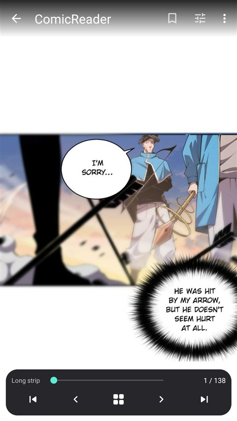

# Emanata Comic Reader

An ad-free, offline comic & PDF reader for Android, focused on image quality,
features and customizability.

- **Formats:** CBZ / CBR / CB7 / CBT / PDF, folders of images; WebP, JPEG XL,
  AVIF, TIFF and more.
- **Rendering:** Lanczos3 scaling everywhere, including GPU Lanczos3 while
  zooming (Android 13+).
- **Private:** no ads, no analytics, no tracking; clean-room Kotlin.
- **No required connection:** works offline. The network is used only for the
  network shares you add, while the app shows something on them: a folder, a
  book, a cover, a favorite, or a share's free space in the Locations sheet;
  to download the AI models you choose and, the first time a cover needs it,
  the 2.4 MB cover text detector (to tell a wraparound cover's front or a
  book's reading direction). The app sends nothing else on its own.

Based on [ComicReader by infinity6901](https://github.com/infinity6901/ComicReader) (MIT).

## Download

Get the latest APK from the [**Releases**](https://github.com/MintyLaboratories/EmanataComicReader/releases/latest) page.

The app id is `minty.emanata` (debug: `minty.emanata.debug`), so it installs
beside ComicReader rather than over it. To bring your library across, back it up
in ComicReader (Settings → Your data) and restore the file in Emanata.

## Screenshots

> Outdated: these show upstream ComicReader and predate Emanata's changes.

| Library | Chapters | Reader — paged |
|---|---|---|
|  |  |  |

| Reader — continuous (webtoon) | End of chapter | Reader settings |
|---|---|---|
|  |  |  |

| Two-page spread (RTL manga) | Favorites | History |
|---|---|---|
|  |  |  |

| Dark theme — settings |
|---|
|  |

## Features

### File browser
- Browse local storage by folder; list and grid layouts.
- Each tab keeps its own view (menu → View changes the current tab; Settings →
  Library has one entry per tab). Browse and Favorites start as grids, History
  and Bookmarks as lists.
- **Grid dimensions:** columns × rows, each Auto or 1–6, picked on a 7 × 7 table
  (tap a cell, or drag and release). Rows share the height below the Recent row
  and above the floating button.
- **Title display:** Hidden, Single line (… at the end), Single line, middle
  (… in the middle, so the year or number stays), Double line (default), Bounce
  (glides to the end, rests, glides back) or Marquee (loops leftward). Only
  overflowing titles move, at about 30 dp/s, all in sync, paused while
  scrolling, with soft edges; with system animations removed they hold still,
  cut in the middle. **Shorten repeated prefixes** (on by default) leaves out
  the series name all items of a Set share (`Lumen - 001.cbz` shows as `001.cbz`).
- **Detail display** (per tab): Hidden, Comfortable (details on their own line)
  or Dense (right-aligned at the end of the title's last line, in small gray
  tabular digits: folders `12`, `3/12`; comics `192 · 87 MB`, `40/192 · 87 MB`;
  bookmarks their page).
- **List density** (per tab): list thumbnail size on a six-step slider, Tiny,
  Compact, Normal (default), Large, Extra large or Huge, applied live. A
  progress badge too wide for its thumbnail shows a percentage, or a dot.
- **Cover shape:** 2:3 (default), 3:4 or the cell's own shape; covers sit in the
  largest box of that shape that fits the cell, centered. **Cover spacing**
  (Settings, 0–32 dp, default 8) sets the gap between grid covers.
- Covers are made at the exact size of their cell (Lanczos3-scaled, drawn 1:1)
  and cached losslessly, from the book's first page not hidden ("Hide this
  page"). Covers already made show at once, ahead of those being made; switching
  tab or folder drops covers still loading, so the view shown goes first.
  Facts found later (page counts, read marks) change only a row's text, never
  its cover. Books whose cover page is a layered AVIF show every visible cover
  from its first layer first, then each full cover replaces it in place.
- **Thumbnail fit:** Fill crops the cover to its box; Fit shows the whole cover
  over a blurred, filled copy of itself; Auto (default) fills when the cover's
  shape is within 10% of the box's, else fits. **Crop anchor** keeps the top
  (default) or the center of a cover cropped for height.
- **Cover text detector:** PaddleOCR's PP-OCRv5 mobile detector on ncnn, run
  on the device, marks the lines of text on a cover (where text is, not what
  it says), to tell a wraparound cover's front and reading direction (below).
  Only title-sized text counts (a letter size of at least 12% of the shorter
  side of the half searched, the height of its line's box, which it grows
  around the text). Found once per cover and kept. The detector is not in the
  app: its 2.4 MB model downloads the first time a cover needs it, as an
  automatic download that the **Skip on metered connections** setting can
  hold back. Until it is there, a wraparound cover without a barcode shows
  whole and is made again once it arrives. Settings → AI processing →
  **Models** shows whether its model is there or downloading (with a Download
  button while it is not), and its size, license and source once its row is
  tapped.
- **Bookmarks** show the book's cover with the bookmarked page in front, at 80%
  of the tile, in the bottom right corner.
- **Wraparound covers** (front and back side by side, about twice as wide as
  the book's own inner pages) show their front, one page wide so the spine
  stays out: the half without the barcode, else the half whose title is
  clearly taller; once a book's reading direction is known, its title also
  confirms the barcode's front (by the text detector, found once per cover;
  its model downloads the first time such a cover needs it). When neither
  tells, the whole cover shows, fitted over a blurred copy of itself, and
  while the detector's model is missing it is made again once the model
  arrives.
- Tabs for **Browse**, **Favorites**, **History** and **Bookmarks**.
- **Toolbar buttons:** Sort, Filter, Favorite (☆/★ for the folder browsed) and
  Search; the others step aside while searching. Settings → **Toolbar
  buttons** shows, hides and reorders them (checkboxes and drag handles); a
  hidden one stays in the menu.
- A **Recent** row sits above the browsing list, empty folders included, and
  opens the folder holding the last chapter you read; it follows a book the
  moment it is opened, names a share's folder after the share, and redraws
  only when it changes.
- **Sort** (toolbar, per tab): Name, Year, Added, Accessed, Size, Length,
  File type or Reading direction, each named by its direction (`newest first`);
  tap the selected option to flip it. Changes apply live; tap outside to close.
  Year, File type and Reading direction take a **Then by** level; Name A → Z
  (natural order, so `page2` sorts before `page10`) breaks every tie. Items
  without a value sort last. **Folders first** is on by default. Browse and
  Favorites start by name, History and Bookmarks by last access (adding a
  bookmark counts). Page counts, ComicInfo years, detected directions (slices
  by their header shape, or as the reader found them) and folder totals are
  found in the background, paused while a book is open; reading direction sorts top to bottom between left
  to right and right to left. Page counts fill in without moving
  rows. A book with inner archives not yet copied out takes ComicInfo's
  `PageCount`.
- **Filter** (per tab): file type, reading direction, read status, year and
  length ranges. A **Filtered** chip shows while anything is hidden; tap it to
  edit, × to clear. While browsing, folders face only the file type rule, so
  the books below them stay reachable. A folder's read status comes from the
  books directly in it; a folder of loose page images counts them as its length.
- **Peek:** spread two fingers on a comic and a grid of its pages grows out of
  it; pinch back to collapse, release part-way to keep it open (scroll, tap a
  page to open there), release fully spread to open the book. On a folder the
  grid shows the covers inside (tap one to open it; fully spread opens the
  folder). Settings → **Pinch to peek**: Off, Peek or Peek & open (default);
  also in the selection's ⋮ menu once turned on there.
- Page grids show each page's **preview** at once, then the exact page in its
  place. Previews (256 px) are kept on disk whenever a page is decoded, for any
  reason; a page never decoded gets a quick one where its format allows (JPEG
  at 1/8 scale, WebP scaled while decoding, AVIF from an embedded thumbnail or
  a layered file's small first layer). A layered AVIF page shows its first
  layer while the full page decodes. Folder peeks reuse the library's
  covers and make missing ones nearest the middle of the view first; from list
  view at the size the grid last drew them.
- Incremental search within the current folder.
- Favorites (star) and reading history, with jump-back to the last page read.
  Every history entry shows its **parent folder below the name**, so bare
  chapters like "Chapter 1" stay recognizable. Tapping a history entry opens
  the book as **Resume where I left off** says. Selected, the floating
  button continues it and ⋮ offers **Show in folder**; the History tab's menu
  holds **Clear history**.
- **Favorites** are grouped into collapsible **Libraries**, **Sets** and
  **Comics** by what they hold (a folder of comics is a Set, comics two or more
  levels down make a Library); "Group favorites" turns this off. Favorites with
  the same name get a grayed prefix that tells them apart (`stacks/Comics`,
  `books…Comics`, `Device…Comics`).
- **Startup tab** and **startup location** (last seen, first or most recent
  favorite folder, or a custom folder picked from the favorites).
- **Resume reading at startup:** Ask (default), Yes or No. As the app starts,
  Ask offers to reopen the book read last at its page; ticking *Don't ask
  again* turns the answer into Yes or No. A finished book is not offered.
- **Selection:** long-press an item in Browse, Favorites, History or Bookmarks
  to select it (its row is tinted; no check boxes). While selecting, a tap
  selects or lets go of an item instead of opening it; letting go of the last
  one, **X** or Back leaves. The toolbar gives way to **n selected** with their
  total size (when every size is known) and **Select all**.
  - A floating bar at the bottom center, in a fixed order: **Move**, **Copy**,
    **Delete**, **Share**, **Rename**, **Favorite**, **⋮**; icons in the
    theme's primary color, names in gray. Rename stays in
    place, grayed, with more than one selected; Favorite adds them all, or
    removes them all when each already is one. Bookmarks offer no Move, Copy or
    Rename, and their Delete is **Remove** (the bookmarks, never the books).
  - **⋮** lists only what applies to the selection: Continue reading (one
    folder: its book in progress, else the next unread), Mark as read, Mark as
    unread, Mark all as read / unread (folders), Set as startup folder (one
    folder), Show in folder (except from that folder itself), Book info (one
    book, without opening it), Filename charset (one book, advanced),
    **Convert ›**, a submenu holding every action that writes a new book (a lone
    one shows as itself): **Pack** and **Pack compacted** (folders on the
    device; off, saying why, unless each holds images only, or when books are
    selected too), **Losslessly compact**, **Make compatible** and **Repack as
    CBZ** (the last for CBR, CB7 and CBT; books on the device; a folder gives
    every book inside it and its subfolders; each off, saying why, where nothing
    selected can be written, or where each book's mark says it had that done
    already; they run whether or not the device is charging), and Peek (off by
    default). Settings → **Selection menu (⋮)** shows, hides and reorders them
    like the toolbar buttons.
  - The floating button: the list/grid toggle with nothing selected (if shown;
    Settings → **Grid/list button tap** makes its tap any view ring action
    instead, its icon that action's, grayed at its end; Folders first and
    Sections toggle the layout outside their tab), **Open** with one (continues
    a book, enters a folder), **Move** with several; Settings → **Button with
    one / several items selected** picks another action or none. Each action
    has its own icon and color from the theme's roles: toggle primary
    container, Open secondary container, Move tertiary container, Copy
    secondary, Delete error container. Without the button, its settings are
    grayed.
  - **View ring:** a long press on the list/grid toggle fans round buttons on a
    quarter arc from the button toward the screen's inside (mirrored when
    left-handed), each labeled with its setting and what a tap does,
    "current→next" (the current part muted): Smaller and Larger (grid columns,
    and rows when set; list density; at the end grayed, showing the size
    alone), Details (Hidden, Comfortable, Dense in turn), Sort (flips the first
    level's direction; long press opens the Sort popup), Folders first (Browse
    only) and Sections (Favorites only) by default; Layout (grid or list) and
    Title lines (each title display in turn) on request. Settings → **View ring
    options** picks them and their order, 3 to 6 in each tab; Folders first and
    Sections count only in their own. A label wraps onto two lines or takes a
    shorter form ("Dir. LTR→RTL") where the full one does not fit; "…" only as
    a last resort. The buttons sit 75 dp apart center to center (closer on a
    tight screen), at least 91 dp from the X; the ring grows only where even
    the shortest labels cannot clear each other. A tap applies at once and the ring stays open; the X in the
    button's place, a tap outside or Back closes it. Or keep the finger down
    and drag: the button it points toward lights up (at any distance, with a
    tick), lifting there applies it and closes the ring, lifting back on the X
    cancels, and resting on Sort opens the Sort popup. TalkBack reads each
    button's setting, value and what a tap makes it, in full words.
  - Several items are one operation, one item at a time: Move and Copy pick
    them all up at once (from the device and shares alike), Delete asks once
    for all, Share sends them all in one share action. File operations work on
    the device and on shares (SMB through smbj, WebDAV through
    MKCOL/PUT/MOVE/COPY/DELETE).
- **Share** asks what to send, each a check box followed by what it sends: the
  title, the cover, the file (with its type icon, name and size); title and
  cover at first, then the last choice. A folder sends its title and cover.
  The share sheet gets one intent: the
  title as text, the cover as a PNG, the file in place through the app's own
  content provider, which other apps read only when granted. Titles sent with a
  cover or file are also copied to the clipboard, one per line ("Titles copied;
  paste them into your message"), as many apps drop the text beside an image.
  Several items
  share at once: their titles one per line, their covers (made one at a time
  only once Share is tapped, counted as they are, and stopped by Cancel; one
  that cannot be made is left out) and the books' files. A share's book is
  never downloaded or copied first: the app picked reads it on demand through a
  proxy file descriptor, any size. While it may still read, a Sharing…
  notification (with Stop) keeps the app running; it goes once no shared file
  was read for 2 minutes. Links stay valid for the books of the 20 latest
  shares (all books of one share together), and while a file is open. The
  first Share or file operation asks once to show notifications. Books other
  apps send or open with this app are taken in every type it shares them as.
- **Operation stack:** one column on the handed side (Settings › Appearance ›
  Handedness, right by default): the floating button at its foot, fixed low
  (snackbars, empty folders and bubbles never move it), and above it a bubble
  for each pick waiting to be pasted and each file operation, the newest
  nearest the button; the bubbles keep their place when the button is hidden.
  At most four buttons show, the button's place included, and always the operation under
  way; older bubbles fold into a count on the top one, which lists them on a
  tap (a Paste's row pastes; each row has Cancel). All file operations (copy, move, delete, rename, compact, make compatible, pack, repack) go through
  one queue, one at a time, never in parallel; several items are one operation,
  done one item at a time. A waiting bubble is gray; the running one darkens
  with a progress ring in its action's color. Tap it for a card (what it does,
  which item of how many, how far, Cancel); long-press it to cancel. When it
  ends it goes, with a short message ("Copied 12 items"), or says why it failed.
- **Move** and **Copy** pick the items up: a **Paste** bubble joins the stack,
  its own high-contrast color (inverse surface) and clipboard icon so it never
  passes for the Move button, with a small badge in Move's or Copy's icon and
  colors, and a short hint. Tap it to paste into the folder browsed in Browse,
  long-press it to cancel. Several picks wait side by side. Names already there
  are asked about once for all: **Replace / Keep both / Skip** (Keep both names
  it `Book (2).cbz`; Skip pastes the others); two items of one name keep both.
  A folder is replaced whole, never merged, and the dialog says so. A folder
  picked up takes along what was selected inside it. A pick is pasted once: its
  Paste becomes the operation, the newest in the stack, and only items a move
  failed at or that a Cancel never reached (canceled while waiting too) come back
  as a new Paste, and a canceled move says so; a canceled copy is gone. Names are checked again as each item's turn comes: one taken
  since, or a Replace that would now replace another item than the one chosen,
  keeps both. A queued Delete or Rename acts only on what was chosen: an item gone,
  changed or replaced by its turn is left alone, and the message says so. An item
  that fails leaves the others going, and the message says how many were done;
  a share found unreachable stops the items left on it, with one message. A move
  within one place is a rename; between places (device and share, two shares,
  internal storage and SD card) it copies, checks each file's size and reads it
  back to compare its CRC-32, then deletes what it copied from the source.
  Links (junctions, symbolic links) are neither copied nor followed when
  deleting. Copies are written under a hidden side name and renamed into place
  once complete, so a canceled or failed one never leaves a half-written file;
  what one cut off part way (the app closed) left is put right when its folder
  is next listed. Within one share the server copies itself (SMB server-side
  copy, WebDAV COPY) where it can. Cancel shows while canceling can stop the
  step under way (not during a rename or a WebDAV COPY, which the server makes
  in one request; several items also stop between two). Operations go on when
  the device turns, and in the background (a notification shows the one under
  way and how many wait; Android 13+ asks once to allow notifications, as the
  first operation starts). Favorite
  folders, folder layouts and start folders follow a folder moved or renamed.
  A deleted item's favorites, history and bookmarks go with it, and what is
  cached for its books (facts, network copy, page sizes, seams, previews,
  nested archives), unless an identical copy elsewhere keeps them.
- **Compact** (lossless compaction) rebuilds the selected books (archives on the
  device; several are one operation, one book at a time) as flat `.cbz` files
  of stored entries in natural order, every page as small as it gets without
  changing a pixel:
  - a JPEG becomes its byte-exact JPEG XL transcode, kept once rebuilding the
    JPEG from it gives back the same bytes;
  - a lossless page (PNG of up to 8 bits, BMP, TIFF that decodes exactly, still
    lossless WebP) becomes lossless JPEG XL in the fewest channels that hold it
    (gray, alpha only when used), kept once it decodes back to the same pixels;
    only pages in sRGB, and PNGs with a color profile, read as stored and the
    profile kept as it is (a lossless WebP with one is left alone);
  - a lossless JPEG XL is encoded again at a higher effort, one holding a JPEG
    transcoded again, each checked the same way;
  - a page is replaced only when smaller; lossy pages (lossy WebP, AVIF, HEIF,
    lossy JPEG XL), GIF, PNG of 16 bits and animations are never touched, so a
    book may mix formats, always pixel-perfect and never larger;
  - names stay but for the extension; when two match, or flat names would
    change the reading order, those in folders take the folder's name in front
    (`sub_001.jxl`), and pages their place in the order too should that not
    keep it.
    ComicInfo.xml and other files are copied as they are; OS litter
    (`__MACOSX/`, `._*`, `Thumbs.db`, `desktop.ini`, `.DS_Store`) and whatever is
    in a dot-folder are left out. A book holding other archives is
    left alone.
  - It asks first, warning: "Pixel-perfect and reversible, but older readers
    may not open JPEG XL pages." **Skip hidden pages** (off each time) leaves the
    pages hidden with Hide this page out; that part can't be reversed.
- **Make compatible** converts a comic into formats every reader opens, and
  reverses Compact losslessly: a JPEG XL holding a JPEG gives back that JPEG
  byte for byte; a lossless one, and an AVIF stored lossless (4:4:4 of 8 bits,
  identity matrix, full range, sRGB), becomes lossless WebP (Android 11+; PNG
  before, for 16-bit pages, for a side over WebP's 16,383 px, and where the WebP
  does not decode back the same), checked pixel for pixel, its color profile
  embedded unless sRGB. Other pages in formats few readers open (lossy JPEG XL,
  which Compact never makes; other AVIF, layered ones too, as their full image;
  HEIF) become very-high-quality WebP (JPEG where a side is over 16,383 px; PNG
  of the decoded pixels when such a page is transparent or too long for JPEG
  too). A TIFF page becomes lossless WebP, checked pixel for pixel (PNG for
  a gray color profile, a side over 16,383 px, and where the WebP does not
  decode back the same; a 16-bit PNG for samples finer than 8 bits hold:
  16-bit, gray of 9-15 bits noted in `sBIT`, palette colors not of 8 bits),
  keeping a gray or RGB color profile;
  one whose colors the reader converts (CMYK, premultiplied alpha) is stored as
  the reader shows it and counted as re-encoded; a JPEG-compressed TIFF stays.
  Lossy re-encoding is the one step that changes pixels: the dialog says so ("Converts the
  comic into legacy formats every reader opens. This may be lossy if no better
  way is found, but aims for minimal visible loss. Comics compacted by Emanata
  convert losslessly."), and the message counts those pages. Other pages are left as
  they are; a page that can't be converted (an animation) stays, and is
  counted and listed.
  - **In place** (shared with Repack as CBZ; off by default, remembered): off,
    the new file goes beside the book (`Book.cbz`, or `Book (compacted).cbz` /
    `Book (compatible).cbz` / `Book (repacked).cbz` when taken); on, it replaces the book once fully
    written and checked (a `.cbr`, `.cb7` or `.cbt` becomes `.cbz`, its old file
    removed). Either way the new file takes the book's favorite, read mark,
    history, bookmarks, hidden pages and own settings (pages renumbered where
    hidden ones were left out); its file name charset is dropped, the new file
    naming its pages in UTF-8.
  - Each file read is checked against the CRC-32 its archive stores (zip; RAR
    and 7z check their own), and every entry of the new file is read back and
    checked against its CRC-32 before it takes its place; a book left as it was
    (nothing smaller, nothing to convert, or holding other archives) is said so.
    The message gives the bytes saved and counts the pages re-encoded; the
    list of pages not converted follows, also when another book failed or the
    run was canceled.
    The new file keeps the book's modification time.
  - Pages convert on up to half the cores (at most four) at background
    priority, fewer as the device warms up or saves power, and only as many at
    once as half the app's memory holds by their size decoded; pages over 64 MB
    are copied as they are (counted as not converted when Make compatible had
    to convert them). Each passes through the app's cache: the files
    unpacked need room there and again for the new file (twice for Make
    compatible), and the run stops before free space drops under 256 MB.
  - A book open in the reader is left out (in use). Should the app stop between
    the new file taking the book's place and the book's data following it, the
    data follows when the app starts again; a new file left half-written in the
    book's folder (`.Book.cbz.<n>.part`) is removed by a later run.
  - JPEG XL: libjxl as jxl-coder ships it (`libjxl.so`), through our own JNI
    binding (`jxl_jni.c`), compiled against the headers of the same release
    (pinned with its SHA-256), and used only when `libjxl.so` reports that
    release; no second copy of libjxl in the APK. Efforts:
    JPEG transcode and lossless 7, recompressing files already JPEG XL 9.
- **Repack as CBZ** copies every page and file of a CBR, CB7 or CBT as it is
  into a flat `.cbz` of stored entries (the Compact rules for names, litter
  and ComicInfo.xml; nothing converted), every entry checked by its CRC-32.
  Solid RAR 5 and 7z archives, told from their headers, unpack every
  page before the one asked for, so they are slow to jump around in and never
  read for seam checks: with **Suggest repacking solid archives** (Settings →
  Library, on by default), opening one on the device offers **Repack as CBZ**
  (with In place) or **Not now**, kept for that book by its Book ID. Repacking
  from there closes the reader; the operation shows in the library.
- Every Convert action's dialog (and the reader's repack offer) says how long it takes with the app open and, when that reads otherwise, with it away ("Takes about 12 min, about 42 min with the app away"); while it runs, its bubble's card, its description and its notification show the time left ("About 5 min left") at the pace of the moment. The estimate comes from speeds measured on this device with the app open and kept in a small file that is not backed up: seconds of wall time per page by action, page format (by name; lossy WebP and JPEG XL holding a JPEG told apart by the first bytes of a few pages) and size class (under 1 MB, under 4 MB, larger), pages converting side by side each charged its share; bytes a second read by location (device or each share, seeded by the share's measured read speed) and archive kind; bytes a second written by location and action, and bytes written per byte of book; and each action's time per book beyond those. Work done with the app away counts only as how many times slower it ran (3.5 before any is measured: the system clocks the cores down for an app not in front). Each figure is learned from real jobs, only the most recent counting, and blends with its seed (calibration's decode timings scale the defaults) until enough is measured. Nothing is decoded to estimate: every book's mark is read (its archive's end only; books past 8 s count as done as often as those read), books are listed (sizes, page names) for up to 1.5 s, and books past that count as holding pages like those listed. While a job runs, the time left blends its plan with how fast the job has gone against it since the plan was made or the app last came or went, the job's own speed counting more as it gets further.
- Compact, Make compatible, Repack as CBZ, Pack and Pack compacted mark their
  new file with one block at the end of its ZIP archive comment: the file's
  history as a chain, oldest first, and one hash, e.g.
  `[i: OtherTool:compact-max:v2, Emanata:compatible:v1 | 9f86d081884c7d65]`.
  Entries are `Tool:action:vN` (tool and action letters, digits, `.`, `_`,
  `-`), separated by commas, `|` before the hash; spaces or tabs may stand
  around every separator and inside the brackets. Emanata's actions:
  `compact` (`compact-partial` when hidden pages were skipped), `compatible`,
  `repack`, `pack` (Pack compacted writes `pack` then `compact`); a version
  per action, raised when its output would improve, so books made by an older
  version are offered it again. The hash is the XXH3-64 of the central
  directory in 16 hex digits (read in either case), which changes with any
  entry; the directory is located by where it ends (so data before the
  archive moves nothing, ZIP64 included), and one over 32 MB is not hashed.
  A rewrite keeps the comment's human text as is (blocks removed, each with
  one line break next to it), appends its entries to the chain (never one the
  same as the last), merges several blocks into one in order, replaces the
  hash, and puts the block on its own last line; when the
  comment would pass 65,535 bytes the oldest entries go first, and no block is
  written when even the newest can't fit or the directory can't be located.
  A chain counts only while its hash matches (a stale one is history only);
  an action is done when its entry is there and no later entry changes pages
  (`embed`, `metadata` and `tag` don't; any other does). A current one
  disables the same operation ("Already compacted by Emanata") while the
  reverse stays offered, and a folder's books already done are left as they
  are; any tool's `compact` or `compact-*` counts as compacted. Reading it
  takes only the file's tail (the end record and central directory).
- **Pack** turns the selected folders of loose images (on the device) into
  books: each becomes `<folder name>.cbz` beside it, stored entries in natural
  order, its images as they are (**Pack**) or each made smaller losslessly by
  the Compact rules, extensions changed and nothing else (**Pack compacted**,
  which warns as Compact does). A `ComicInfo.xml` beside the images goes into
  the book too. A folder holding anything else (OS litter aside: `Thumbs.db`,
  `desktop.ini`, `.DS_Store`, `._*`, `.nomedia`, `__MACOSX/`) or another folder
  can't be packed: the items show off, saying why. Unusual files (dot-files,
  dot-folders, empty files) are never packed silently: one question for all
  the folders, listing them, "Pack these unusual files too?": Yes packs them
  as files (dot-folders under their own paths), never as pages; No leaves them
  out, and they are deleted with the folder; Cancel packs nothing. A `.cbz` of
  that name already there asks, as Paste does: Replace, Keep both or Skip; one
  that turns up while packing makes it keep both, as the message then says.
  Every entry is read back and checked against its CRC-32 before the new file
  takes its name; only then does the folder take its data along and go (its
  files, still as they were, its unusual files and its litter). One queued operation, a folder at a time;
  canceled, the folder stays as it was. The new book takes over the folder's
  favorite (or an image's), its layout (kept as the book's own: "This folder"
  in the reader then keeps it for the book) and its answer to reading tall
  pages as a strip; it is read when every image was, resumes at the image read
  last, and has the images' bookmarks and hidden images on their pages, and the
  color adjustments of the image read last.
- **Book ID:** everything kept for a book (favorite, read mark, history,
  bookmarks, hidden pages, its own settings and color adjustments, cover, page
  previews, sizes and seams, facts, network copy) is kept by an ID made from its
  contents: XXH3-64 of its size, first 32 KB and last 32 KB (all of it under
  64 KB). It follows the book moved, renamed or copied anywhere, inside the app
  or not, even to another device, and identical files share it; a file replaced
  by another at the same path does not inherit it. An index of path, size and
  modification time keeps each file's ID, so a file seen before is never read
  again for it; on a share both ends of a book are asked for at once, and
  opening it next starts from them. Listings find the IDs of unseen books in
  the background, except loose images and on shares whose covers are not made;
  a share that sends files only whole is never read for them: a book there
  gets its ID from its local copy once fetched. Lists show each book where it
  was last seen, and backups carry the IDs with those paths.
- **Re-encoded copies:** each book opened keeps a likeness: its ComicInfo.xml
  without `<Pages>` and `PageCount`, plus its page count, when ComicInfo names
  the book (series and number, or a title), else its page names without
  extensions, page count and file name without extension. A book opened for the first time that is
  like a book with data kept asks once, naming that book, whether to carry its
  favorite, read mark, history, bookmarks, hidden pages and settings over;
  what is kept by page follows the page of the same name, else of the same
  place. Never automatic. Backups carry the likeness of each book with data
  kept, so a copy still matches after a restore.
- **Forget missing books** (Settings → Your data) scans every location for the
  books your library keeps data for, with progress and Cancel; it walks
  archives and PDFs, known files cost no reads, and an unseen file is read only
  when its size is a missing book's (several at once). Loose images, books
  opened from outside every location and books of unknown size are looked for
  where they were. A book found elsewhere notes where. Books found nowhere are
  listed for review before anything is forgotten. Books last seen in a location
  not reachable now (a share offline, storage not mounted, a listing that
  failed) are kept and the location named; then the others are listed
  unticked, as they may have moved there. Also unticked: a book whose path
  holds another file now, and one whose place is not known.
- Location bar below the tabs as tappable crumbs (`Device / Comics / Series`), roots
  named (`Device`, the SD card's label), at least 48 dp tall; back navigates up,
  never above a root. Going up keeps the deeper folders as gray **forward
  crumbs**; opening another folder drops them.
- A folder that no longer exists (crumb, favorite, History's Show in folder,
  startup location, folder picker) opens its nearest existing parent with a
  note; forward crumbs past it are dropped.
- **Locations:** the crumbs start with the app's icon in the theme's color
  (`[icon] / Device / Comics`); it opens a sheet of every
  location with its free space: the device, SD cards, **USB-OTG drives**
  (Android 11+, with all-files access) and network shares. Drives appear and
  disappear live; plugging one in opens the sheet with it highlighted (at once
  in the library, else on returning to it); pulling one out while a book on it
  is open closes the book and says why.
- **Start folder per location:** long-press the device or a share in the
  Locations sheet to pick the folder it opens at (its top by default); picking
  that location opens there. A startup folder on a share is waited for up to
  the **Network timeout**; after 2 s without an answer a dialog naming the share
  ("Waiting for Share A…") offers **Wait** (the list keeps spinning) or **Open
  device** (the device's start folder at once). When the timeout passes, or the
  share cannot be reached, the dialog closes and the device's start folder
  opens with a note. While the app is shown and that folder browsed,
  an unreachable share is asked again, less often each time (at most every
  5 min); a bar offers to open it once it answers, or says why it refused. A
  refused sign-in is never retried unasked.
- **Network shares (SMB 2/3 and WebDAV):** "Add network share…" in the
  Locations sheet asks SMB or WebDAV, then takes a name, a path, a user and a
  password; everything else is defaulted. SMB: the path is `host/share/folder`
  (`\\host\share` and `smb://` work too), the user `DOMAIN\user` or blank for
  a guest; port 445, the dialect negotiated, never SMB1, signing and
  encryption as the server requires. WebDAV (tested with rclone; other
  servers untested, and HTTPS needs a certificate Android trusts, so
  self-signed ones fail): the address is `https://host/folder` (`davs://` or a
  bare `host/folder` work too), signing in with Basic over HTTPS; plain
  `http://` only to private addresses (192.168.x.x, 10.x.x.x, 172.16–31.x.x,
  link-local, `.local` names), with a warning that the password then crosses
  the local network readable. Books are read with HTTP Range requests; a server without them
  sends whole files, so its books are always fetched to the cache first, and
  get their covers once fetched. WebDAV shares show a cloud in the sheet, SMB
  ones a server, with their free space when the server tells it (kept, and
  asked again when the share is opened, or when the sheet opens and it is over
  an hour old). Passwords are sealed with a key in the Android Keystore.
  Long-press a share in the sheet to edit or remove it; a blank password keeps
  the saved one only on the same server, and "Clear password" removes it.
  "Load thumbnails" (on by default) can be turned off per share for slow
  drives: covers already made still show. Removing a share can also forget
  its favorites, history and bookmarks (not ticked by default). A share is browsed like a drive: its name is the root crumb and
  the root of same-name labels; favorites, history, bookmarks, the startup
  location, sort, filter and peek work there. A folder browsed before shows
  at once as it was last listed (kept in memory and on disk), is listed again
  in the background, and changes in place only if something changed; item
  counts of its subfolders fill in after it shows, listing again only those
  whose time changed. Books are read in place, only the parts needed
  traveling: CBZ, CBT, and CBR and CB7 that are not solid, straight from
  their entries; a solid CBR or CB7 is streamed once, front to back, its pages
  kept as they are unpacked, so even a book of several GB opens without being
  downloaded whole. Long reads keep several requests in flight, over a second
  SMB connection too (one connection's window caps what a link with a long
  round trip carries), and a book streamed front to back has its next parts
  fetched ahead (not while battery saver holds back read-ahead, which also
  keeps to one connection, and only while memory allows); pages read at the
  same time take turns in shorter runs; walking an archive's headers stays in
  small reads. PDFs and loose images are fetched to a **Network cache**
  (Settings, 2 GB by default, which also holds the kept pages; least recently
  read first out) before the reader opens them; a PDF gets its cover once read.
  A server waking a sleeping disk is waited for: connecting, signing in,
  listing and each read wait up to the **Network timeout** (advanced setting,
  30 s by default);
  a book or page that shows nothing for 2 seconds while the reader's own
  requests go unanswered (covers and scans on the same share do not count)
  shows a spinner and "Waiting for network location…" until data arrives. A share that
  cannot be reached says so ("Not reachable") with a Retry, also over a folder
  shown as last listed; a refused sign-in is not tried again until you retry
  or edit the share, so a
  wrong password cannot lock the account; favorites and history show shares
  without waiting for the network, and a favorite folder there is sorted into
  its section once looked into (a spinner meanwhile). Items on shares can be
  renamed, deleted, moved and copied, and New folder works there too. An SMB connection stays signed in for 10
  minutes unused (30 while a book on it is open), echoed every 2 minutes so
  the server and network keep it, and is made again silently when it dropped;
  coming back to a share within that time signs in no more. Backups include
  the shares; their passwords are sealed with a key derived from the app's
  device ID, bound to the share's server and user, so a restore on the same
  device (even after a reinstall) keeps them, while on another device each
  share asks for its password when opened. "Without passwords" in the export
  leaves them out; a restore never replaces a password that works with one
  left out or older.
- **Metered connections and slow shares** (Settings → Network): **Skip on
  metered connections** picks which optional network work waits while the
  connection costs by the byte (mobile data always does): covers from
  shares, similar-books hashing on shares, read-ahead on shares (pages
  beyond those shown, and the next chapter in a strip), automatic
  model or detector downloads, or any network use you didn't start (all of
  them by default). Opening a book, a search, Download and Compare always
  run; Find duplicate files counts reading share files as hashing, and its
  Compare reads them anyway. **Warn before opening a large book on a metered connection** (on, 100
  MB by default) asks before a larger book on a share opens: Open anyway or
  Cancel. Each share has a **Speed**: Auto, Fast or Slow. Auto measures the
  share's real reads (median throughput of long reads, timed while any is
  under way, and median wait for short reads' first byte, so one disk
  spinning up does not count) and counts it slow below 2 MB/s or over 1 s to
  the first byte; the share's form shows what it measured. **On slow shares,
  skip** works like the metered choices (by default: background hashing,
  read-ahead beyond the page shown, and covers of books not on screen). A
  change to either reaches an open book's read-ahead and scans at once.
- Folder rows show "N items · M read"; a folder whose items are all read gets the
  read badge. **Continue reading** jumps to the next unfinished book in a folder,
  and a whole folder can be marked read or unread.
- **Search subfolders** (menu) looks below the current folder, not just in it.
- Opening a book resumes at the last page unless it was already finished.
- Files opened from other apps (`content://`) are copied to the cache and opened.
- Housekeeping: **duplicate file finder** (bit-identical copies, SHA-256
  verified, shown as one cover with every place a copy is; spread two fingers
  on it to peek; below them, **similar books** in other files, such as a CBZ
  re-encoded from JPEG to JPEG XL or WebP: page counts within one and
  perceptual hashes (dHash) of the cover and pages a quarter, half and three
  quarters in, shown side by side with format, size and page dimensions,
  never preselected; PDFs and books under 8 pages must match more closely;
  pages are read once per book and kept by Book ID; the search shows its
  progress and can be stopped; it reads up to 20 new books unasked, more on
  **Compare**, and none unasked while battery saver pauses scans; fewer at
  once as the device warms up or saves power), **largest files** list,
  reading **statistics** (books read, pages read, time reading, days read,
  streaks; a book is a PDF, a CB* archive, or a folder of loose images, which
  counts once when all its images are read or it is marked read; books read
  goes down when one is unmarked, never below 0), and **backup / restore** of
  your library, settings
  and network shares (Settings → Your data) to a JSON file you choose.

### Reader
- **Formats:** images (`jpg`, `jpeg`, `png`, `gif` (first frame), `bmp`, `webp`,
  `avif`, `heic`/`heif`, `jxl`, `tif`/`tiff` (first page)) and archives
  `zip`/`cbz`, `rar`/`cbr`, `7z`/`cb7`, `tar`/`cbt`, plus `pdf`. The extension
  decides which images are listed; their content decides how they are decoded.
- **Broken pages** show a placeholder naming the page and the reason.
- **Archives:** recognized by content, so a `.cbr` that is really a zip opens.
  Pages in subfolders keep folder order. Archives inside an archive (one per
  issue) show their pages in place. macOS, hidden and empty entries are skipped.
- **Layout × direction:** *Paged* or *Continuous*, read *Left to right*,
  *Right to left* or *Top to bottom*. Paged top to bottom swipes up, one page a
  screen, snapping. Continuous reads top to bottom only: one scrolling column
  with a **page gap** (0 for webtoons) and optional auto-crop (never for
  detected slices, whose blank bands and widths belong to the strip). Two-page and
  split spreads are for paging left or right. The older Vertical mode reads as
  Paged top to bottom, Long strip as Continuous top to bottom, per folder too.
- **Two-page spread:** Off, On or Landscape only; facing pages side by side
  (respects RTL ordering), paired by their page numbers rather than position.
  The first page (setting), covers and variant covers, inserted pages (`156b`),
  wide pages and filename spreads (`-023-024`, `p190-p191`, `22+23`) show alone,
  and pairing starts over after each; issue-page names (`Title 001-002`) are not
  spreads. A spread's numbers tell which pages face each other. **Shift pairs by
  one page** fixes a book that still pairs wrong, and is kept for that book.
  Page sizes come from image headers, read once per book in the background.
- **Spreads in two files** are told by their seams: the facing edges of two
  pages, decoded as thin strips, must agree in color and shape within a fixed
  limit, or about as well as each edge agrees with columns inside it (a few
  columns trimmed at the cut are allowed for); blank, flat or nearly empty edges
  say nothing. In two-page mode such a pair shares a screen even when page
  numbers would pair it otherwise (the seams of that run decide; **Shift pairs
  by one page** still flips the result), and its gutter is never cropped. Seams
  are checked in the background at low priority, nearest the page on screen
  first, from the reader's own decodes; beyond them only baseline JPEG pages,
  whose strips decode alone (a progressive JPEG decodes every scan for any
  strip, so such a book waits for the reader's decodes too). They are kept per
  book. Once you turn a page, a seam found later never
  re-pairs the pages you are on. A single strong match re-pairs its run only
  within a few pages of one you have had on screen, in this or an earlier
  session (pages seen are kept beside the seams). **Join spreads by their
  edges** (on by default, also in the reader sheet) turns this off; **Ignore
  seams in this book** (reader sheet, two-page or Merge) does so for one book:
  no seam checks, pairing or joining.
- **Spreads:** *Merge* (default) shows a wide page whole, and a spread in two
  files as one; *Split* shows a wide page as two pages, each numbered and fitted
  on its own (one page at a time only).
- **Wide pages in portrait:** what a wide page or a merged spread shown whole
  does in portrait. *Rotate image* (default) draws it turned a quarter to fill
  the screen, its top to the right (to the left when left-handed), and locks
  the screen while it shows, so you turn the device to read it; swipes and tap
  zones stay with the device, pinch and pan follow the picture. *Change
  orientation* turns the screen to landscape, either way up, until a page that
  is not wide shows; then the reader's own orientation is back. Lying flat,
  where the sensor cannot tell which way is up, the screen turns back to the
  way it was and stays so until the device is picked up. *Do nothing* shows it
  as it is. In continuous reading, in landscape and in split screen nothing
  turns.
- **Page thumbnails:** grid picker to jump straight to any page.
- **Crop:** crop the current page to a PNG.
- **Reading direction:** left-to-right, right-to-left (left/right tap zones
  follow unless mirroring is turned off) or top-to-bottom. **Detect reading
  direction** (on by default) first reads slices of one tall strip (webtoons,
  manhua) top to bottom in one column: pages two to ten times as tall as wide,
  of one width, from their headers; varying heights settle it alone, otherwise
  the seams must run on (the bottom rows of one slice against the top rows of
  the next, decoded as thin strips; blank seams are skipped). The finding is
  kept per book. Seams are read in archives and single images; PDFs tell by
  shape only, and loose images in a folder (one chapter each) are not checked.
  It then reads a
  book right to left from, in order: ComicInfo
  `Manga=YesAndRightToLeft`; a wraparound cover's front half, only when its
  barcode and its tallest title agree on it (kept per book); a manga publisher in ComicInfo `Publisher` or a bracketed tag in the
  file or page names (`[Kodansha Comics]`). Manga-style page names
  (`c001 (v01) - p000`) do not decide on their own, as western scans use them
  too. A short note on open says why ("Right-to-left (from ComicInfo)").
  Choosing a direction keeps it for the book's folder, and only the direction;
  a folder's direction always wins over detection (a folder read top to bottom
  still shows slices in one column). **Auto** hands it back to detection and the
  default. "Apply to: This folder" keeps its layout as it is.
- **Tap zones:** left/right, right/left, top/bottom, bottom/top or off; the outer
  thirds turn the page (a whole spread in two-page mode) as the finger lifts,
  the middle third toggles the UI. Books read top to bottom take top/bottom in
  place of the default left/right.
- **Zoom / pan:** pinch-to-zoom, drag to pan, double-tap to zoom or reset (in
  the middle third where tap zones turn pages, so turning never waits for a
  second tap).
  While moving, the page is drawn through a Lanczos3 GPU shader with an
  anti-ringing clamp (Android 13+; bilinear before). 150 ms after it stops,
  the visible part is re-rendered with Lanczos3 from the full-resolution page
  (vector for PDF) at exact screen resolution and swapped in pixel for pixel.
  Only the zoomed page or spread is kept at full resolution, within a memory
  budget, and it is freed when the reader is hidden.
- **Fit modes:** fit screen, fit width, fit height, stretch. Each page is
  scaled with Lanczos3 to the exact size it fills on screen (a spread half, or
  the whole row for a lone page) and drawn pixel for pixel, unfiltered. A new
  fit shows at once, the page rescaled on the GPU, and its exact bitmap takes
  over in place when ready; recent fits of the pages on screen stay cached.
- **Page filter:** none, invert, grayscale, high contrast, sepia. Invert flips
  lightness only, in OKLab, so colors keep their hue (Android 13+; an RGB
  invert before).
- **Auto-scroll** at one speed for every mode, in screen heights per minute
  (0.25 to 45): strips scroll that far each minute; paged mode turns the page
  when one screen height would have scrolled past, a thin bar along the bottom
  edge filling meanwhile. Touching the screen takes over.
- **Auto-crop** trims blank page borders; pages ahead are **preloaded**, and the
  screen before the one shown, so a turn back is ready too; a page not ready
  yet shows its small preview until it is. Two
  pages side by side share one top and bottom crop and show at one height,
  meeting at the gutter; a spread in one file is cropped whole before it is split.
- **Chapter drawer** (toolbar button, or Chapters in the menu): *Chapters in
  this book* (its folders, or the inner archives of a nested book) and *In this
  folder* (the files beside it), the current ones highlighted; tap one to go there.
- **Page actions** (Page ▸ in the menu): share or save the page as an image,
  crop it, hide it, or rotate the screen. With two pages on screen, the menu's
  **Hide this page** asks which one.
- **Page menu** (long-press a page; with two pages on screen, the one pressed):
  a row of **Share**, **Save**, **Crop** and **Bookmark** (**Remove bookmark**
  on a bookmarked page), then rows Settings → **Page menu (long-press)** shows,
  hides and orders:
  - **Hide this page**
  - **Set as cover:** the page becomes the book's cover in the library (and its
    folder's, where it is one); on that page, **Use the first page as cover**
    undoes it. A hidden cover page gives way to the first page shown. Kept per
    book, backed up, cleared by Clear library data.
  - **Page info:** its name in the book, pixel size, format (lossless or lossy,
    progressive JPEG, animated, layered AVIF with its layer count) and file size.
  - **Show alone / Pair with next** (two pages a screen, or spreads merged): for
    when seams or Shift pair pages wrongly. A page shown alone breaks its run; a
    page paired with the next shares its screen whatever it is, and the pages
    after it pair on from there. Undoing a choice comes first when that is
    enough. Kept per book, backed up, cleared by Clear library data.
- **Hide this page:** a hidden page is left out of reading, page counts, the
  seek strip, page grids and peeks for that book; history and bookmarks keep
  their pages, except a bookmark on the hidden page, which moves to the next
  shown page for good (joining its note to a bookmark already there).
  **Unhide pages…** in the ⋮ menu (disabled while none is hidden) shows them
  again. Kept per book, moved with it, and backed up; restoring a backup made
  without them shows every page again.
- **Apply to: This folder / All books** at the top of the reader settings:
  *This folder* keeps the whole layout (paged or continuous, direction, fit,
  two-page, spreads, auto-crop, page gap) for the book's folder; *All books* changes the defaults and
  keeps only a direction chosen for the folder.
- **Book info:** file, folder, format (from the file's leading bytes, e.g.
  "CBZ (ZIP)", or "CBR (actually ZIP)" for a misnamed one), size, pages (and how
  many are hidden), the
  reading direction with where it comes from, and every ComicInfo field.
- **Adjustments:** brightness, contrast and saturation, each -100..+100, computed
  in OKLab on the GPU in the same pass as the page's scaling (Android 13+), live
  while dragging. Brightness blends toward black or white, contrast scales
  lightness about mid-gray, saturation scales chroma within the sRGB gamut.
  Changes are per book with a reset to the defaults set in Settings. A **night**
  filter sits on top.
- **Brightness drag:** paging left or right, drag up for brighter, down for darker.
  Crossing 0 holds there for 15% of the screen height. A drag locks to its first
  direction: vertical never turns the page, horizontal never changes brightness.
  It starts only with the finger down on the page image itself (not its margins
  or letterbox) and outside the system's gesture areas (the home strip at the
  bottom, the back edges at the sides), so system swipes never change it.
  A pill near the top shows the value (`Brightness +12`) over a -100..+100 bar,
  ticks and highlights 0 on snapping there, and fades a second after release.
- **Seek bar previews:** hold the seek bar still for 0.4 s and a strip of
  numbered page previews opens above it, the current page centered and
  outlined, in reading order, the page behind dimmed. Pairs show both pages
  and split spreads their halves, numbered as the reader numbers them. Scroll
  it sideways, tap a page to jump there; a tap outside, Back or hiding the UI
  closes it. Dragging the seek bar right away seeks as usual.
- **Page gap** slider: a margin around each paged page, or the gap between the
  pages of a column.
- **Next / previous chapter** buttons, plus an **end-of-chapter card** with a
  direct link to the next chapter, centered at 75% of the screen height.
- **Auto next chapter** (on by default): reaching the last page rolls straight
  into the next chapter and the end-of-chapter card is skipped entirely (it still appears
  when the setting is off, or on the last chapter of a folder). In a
  **continuous** column the next chapter's pages are already laid into the strip,
  so scrolling (or an upward flick) simply continues into them the way page-to-page
  scrolling does inside a single archive - no stop, no reload, no end card.
- **Previous chapter on repeated back** (Disabled, 2 or 3 swipes; default 2):
  going back on a chapter's first page (swipe, tap zone, volume key) shows
  *Swipe back again for the previous chapter*; the last one within 1.5 s of
  the one before opens the previous chapter at its last page or spread; a tall
  last page shows from its bottom, as any tall page turned back to.
- **One-page files** (a loose image, or a one-page archive) read as pictures of their folder, whatever the two settings above: no end-of-chapter card, one turn forward opens the next file, one back opens the previous file. A tall image scrolls first: reached by going back, it shows from its bottom, and the file before it opens only from its top.
- Bookmarks per page (toolbar ribbon button, filled on a bookmarked page), plus a
  bookmark list to jump between them.
- **Favorites ▸** adds the open comic, or the folder it is in, to the favorites,
  or removes it.
- Go-to-page, orientation lock, rotate, keep-screen-on, immersive fullscreen,
  and tap-to-toggle the UI bars. Volume keys turn pages.
- The **reader settings** sheet holds every reading option in three groups:
  Layout (paged or continuous, direction, fit, two-page, shift pairs, spreads,
  auto-crop, page gap), Color (filter, brightness, contrast, saturation, night filter)
  and Behavior (auto next chapter, auto-scroll speed, keep screen on, fullscreen,
  orientation, wide pages in portrait).
  Each single choice is a row of segmented buttons with one always selected. It
  opens over half the screen, so changes show behind it.
- The overflow menu stays short: Go to page…, Chapters, Bookmarks, Favorites ▸,
  Auto-scroll, Page ▸, Unhide pages…, Book info, Settings.
- **Resume where I left off:** Ask (default), Yes or No. Ask offers *Resume
  page* or *First page*, with the page number and percentage; ticking
  *Don't ask again* turns the answer into Yes or No. Only a book with a saved
  position asks; a finished book opens at the first page. Chapters opened
  explicitly (history's Continue reading, bookmark, chapter drawer, next-chapter)
  never ask.
- Per-book reading position is stored in history.
- Every reader option is written back to preferences, so the layout, fit, filter,
  spacing, direction and toggles **persist across chapters and app restarts**.

### Settings
- **Search** (toolbar) finds settings by title, description or any of a list's
  options, ignoring case and accents, title matches first; each result shows
  its section (an AI step
  also its chain). Tapping one expands its section, scrolls to it and tints it
  briefly. With Keep it simple on, matching advanced settings are listed,
  tagged Advanced, and the one opened shows without turning anything on.
- **Collapse all** folds every section while any is expanded; otherwise the
  same button reads **Expand all**.
- **Changes apply at once**, also to a reader or library open under Settings:
  each screen checks the stored settings when it shows again. Gestures change
  on the pages shown, without building them again. Settings about opening a
  book (resume, repack offer, large-book warning) apply to the next book
  opened; startup settings to the next start. After a restore or Clear library
  data, a book open under Settings opens again at the page it showed (also when
  a language change or the system closed the reader meanwhile), wherever its
  hidden pages and filename charset as stored now put it, with its own settings
  as stored now; cleared favorites show cleared in its menu.
- Theme: system / light / dark.
- Per-app language: system or English (Simplified, en-US).
- Archive filename charset (UTF-8, CP949, Shift_JIS, GBK, Windows-1251). An
  open book stays on its page when the new names reorder its pages.
- Default reading direction, layout, fit, filter, page gap.
- Default adjustments (brightness, contrast, saturation) for every book.
- **Linear-light scaling** (off by default): pages and covers are shrunk in
  linear light, so halftones and screentones keep their brightness; thin dark
  lines come out lighter. Enlarging stays in sRGB.
- Reader: resume where I left off (ask, yes or no), open the next chapter
  automatically when a chapter ends, and how many backs on a first page open
  the previous one.
- Gestures (tap zone layout and right-to-left mirroring, volume keys, brightness
  drag, double-tap zoom, and **momentum scrolling**, on by default: zoomed
  pages keep gliding after a flick and stop at their edges).
- File-list options (title display, status bar, breadcrumb, quick button).
- **Clear cache** (showing the space it takes): covers, page previews, page
  sizes, seams and pages seen, book facts, the Book ID index, network copies,
  share listings and nested archives, all made again as needed. **Clear library
  data**: everything kept about your books and folders (favorites, read marks,
  history, bookmarks, hidden pages, books' and folders' own settings, tall-page
  answers) and shared-book links, but not reading statistics; it offers Export
  first and clears only once "Delete them for good" is ticked. **Clear reading
  statistics** (Settings → Your data, or Reading statistics in the library);
  read marks stay. Also clear history, clear bookmarks, reset
  all settings; every Clear or Reset asks first. Resetting settings keeps
  per-book adjustments and reading progress.
- **AI processing** (off by default): two default chains, **Manga**
  (black-and-white pages with dot patterns) and **Everything else** (color,
  and black-and-white without dots), each a model per step, or none, for
  artifact removal, then descreening, then upscaling (waifu2x UpConv7 2× by
  default in both; only a choice is stored, so a step never chosen follows a
  later default). Under each chain's pickers a load estimate bar sums its
  models' page times (this device's as the reader measured them, each page
  moving a model's time a quarter of the way; a model not run yet takes the
  reference tablet's time scaled by how the measured ones of its engine,
  ncnn or GPU shaders, compare with theirs, or before any of its engine by
  the other's, corrected for the shader times being warm upper bounds; an imported model its own
  time, measured on this device) on a scale to 30 s: green below 10 s, yellow to 20 s,
  red past it, with no unit or numbers; TalkBack reads it as light, moderate
  or heavy. Upscaling also offers Anime4K's GPU
  shaders (modes A, B and C, Upscale, Upscale + Denoise) in every size from
  S to UL, CuNNy DS in seven sizes (faster, fast, 4x12, 4x16, 4x24, 4x32,
  8x32) and ArtCNN DS in two (C4F16, C4F32). A step's picker shows each choice by a short name (without the
  step's own words, e.g. OpenComic 2×), its speed in stars (five up to 1 s
  a page, or up to the fastest model's time when that is longer; one for
  slow models; linear in page time on the reference tablet in between; none
  for imported models, timed on this device) and
  an info button that shows, and on a second tap
  hides, its full name and size, its star ratings by eye (Crisp: makes
  blurry or artifacted art crisp; Color; Detail; Desharp; Lines; an empty
  star means it makes that worse; models not compared yet show none) and
  what it fits best, then its biggest downside. A family takes one row with
  a level slider: the sizes of Anime4K's modes, CuNNy and ArtCNN, whose
  ratings are their largest size's ("up to"), and waifu2x's denoise
  strengths, each with its own. A tap on a
  row picks it and closes; letting go of a slider (or, moved by keyboard or
  screen reader, letting it rest half a second) picks that level and keeps
  the picker open. Models that take 10 s or more for a 1000×1500
  page on the reference tablet are marked slow with their time, and are
  offered only with Keep it simple off (or once chosen), in Settings, the
  reader's sheet and Models alike. Artifact removal and descreen are advanced settings;
  the switch's summary shows both chains, hidden steps included, and, when
  one's load estimate is red, notes that heat or battery saver may pause AI
  processing (heat alone while **Pause AI processing** is off). A chosen model
  downloads at once (a slider's level as the picker closes; a level passed
  over on the way stops what the pages shown fetched for it, deleted as the
  picker closes unless it was there or on its way before), and one cut
  short with the app resumes as Settings open
  (Models shows each with what it does and its progress, its size, license
  and source once its row is tapped, and deletes them; models an update drops
  are deleted at the next start). **Import a model…**
  in Models takes your own ncnn model (a `.param` and its `.bin`, converted
  on a computer, e.g. with pnnx; nothing is converted on the device): the
  pair is copied into the app, checked as catalog models are and timed on a
  test page, then shows what it makes of three test pictures (clean art with
  gradients, JPEG-compressed art, art with dot patterns, each cut to what
  the model runs in one tile), before and after at the same size (the
  before zoomed 2×, or to an upscaler's output; the after never shrunk,
  pixels repeated, not blended; side by side, or stacked in a narrow
  window, still the same size), judging nothing: **Continue** or **Discard**; then it is
  named and given its step (1× models remove artifacts or
  descreen, larger ones upscale), with a warning that heavy models may be too
  slow to run live. A model taking over 30 s a page goes on only after
  **Import anyway** (Cancel drops it); one past the reader's 120 s a page, or
  one the engine can't run safely, is refused with the reason. Imported
  models are marked as such (no license is claimed), are offered at their
  step like catalog ones, and can be deleted. Battery: battery
  saver pauses AI processing unless **Pause AI processing** is off; pages
  processed before still show. In the reader a page shows at once, then its
  processed version takes its place at the same size when ready: the page
  read first, then the next screen's, one at a time; turning pages faster
  than they are processed, the work skips ahead to pages it can finish in
  time. A book read right to left runs the Manga chain, others Everything
  else, unless Reader settings → AI processing → **Default chain** picks one
  for its whole folder (**Same for the whole folder**, on by default) or for
  the book alone; both kept with the library's data. Each book can also run
  its own models (**This book**), kept with its other data; **Default**
  follows Settings, and a change there changes that default chain. The sheet
  shows the load estimate of the chain the book runs under its pickers, with
  the same note when it is red. Processed pages are
  kept on disk (up to 1 GB and a tenth of the free space, cleared by Clear
  cache).
- **Models by page size** (Settings → AI processing, advanced): one slider
  with two handles on the size a page is shown at, as a share of its side
  after the 8 MP reduction. Upscaling models run on pages shown above the
  upscale handle (100% by default, never below 50%, where an upscale is
  always resampled away); artifact removal runs above the cleanup handle
  (50% by default, down to Always). The handles may cross; a sentence under
  the slider says what they do. Descreen, when chosen, runs at every size.
  With Keep it simple on, sizes set away from the defaults show in the AI
  processing switch's summary.
- **AI indicator** (Settings → AI processing, advanced; off by default): a
  small teal dot outlined in magenta in the reader's bottom right corner
  while models work on a page of the open book, read-ahead included. It
  shows after 0.3 s of work and hides once the queue is done, put off (heat,
  battery saver) or gave up; pages read back from disk don't show it. It
  stays inside the screen's insets and rounded corner, clear of the bars. On
  a page drawn turned (*Rotate image*) it moves to the corner that is the
  page's bottom right as it is read: the screen's bottom left, or its top
  right when left-handed.
- **Optimizing for this device**: at first launch, once the library shows, a
  full-screen calibration times how fast the device decodes and resizes pages
  (about 40 s; a comic page whose gutters slide one at a time keeps it company)
  and keeps the setup that is fast without wasting battery. **Cancel** keeps
  what is in effect (the defaults the first time) and asks again at the next
  launch, **Keep old calibration** (not on the first run) keeps the previous one
  until the next system update or Recalibrate, **Continue in background** lets
  it run unseen while the app is open and idle. After a system update a banner
  in the library offers it again ("Optimize for this device (~N s)": Start, Later,
  Skip); **Settings → Performance → Recalibrate** runs it any time. No charger
  needed; too warm or under 20 % battery, it says so and stops; with battery
  saver on it offers saver's settings or **Measure anyway** (replaced by the
  next run without saver). The screen stays on while it runs.
- About: version, source, upstream credit, the license, third-party licenses,
  and the AI models' authors and licenses.

## Format support mapping

| Extension | Handler | Library |
|---|---|---|
| jpg/jpeg/png/gif/bmp/webp/heic/heif | `ImageSource` | platform `ImageDecoder` (`BitmapFactory` below API 28) |
| avif | `ImageSource` | libavif with dav1d, built from source (`app/src/main/cpp`) |
| jxl | `ImageSource` | libjxl as jxl-coder ships it, through our JNI binding (`jxl_page.c`); jxl-coder itself for images without an sRGB rendering |
| tif/tiff | `ImageSource` | built-in `Tiff` (strips/tiles; none, PackBits, LZW, Deflate; JPEG via the platform) |
| zip / cbz | `ArchiveSource` + `ZipReader` | `java.util.zip` |
| rar / cbr | `ArchiveSource` + `RarReader` | libarchive 3.8, built from source (RAR 4 and 5; see RAR limits below) |
| 7z / cb7 | `ArchiveSource` + `SevenZipReader` | Apache Commons Compress |
| tar / cbt | `ArchiveSource` + `TarReader` | Apache Commons Compress |
| pdf | `PdfSource` | platform `PdfRenderer` |

- The backend is picked from the file's magic bytes (`ArchiveKind`), the
  extension only when they match nothing.
- RAR limits: these do not open ("Cannot open this file"):
  - solid RAR 4: libarchive 3.8.11 cannot read it past its first entry;
  - RAR 5 with any entry's dictionary over 64 MiB (libarchive's limit;
    WinRAR's default is 32 MB);
  - encrypted RAR (entries or headers).
- Every image, in an archive or not, decodes through `Decoders`, which picks the
  decoder from the magic bytes (`ImageKind`). PNG, JPEG XL and TIFF sizes come
  from the header alone (`ImageHeaders`, `Tiff`).
- The reader's pages the platform decodes (JPEG, PNG, WebP, HEIF; one thread
  each), shown or read ahead, run with their thread pinned to the large cores
  (`PlatformPages`): left to the system, such a decode often starts on a little
  core and stays slower there. Covers, previews and scans stay with the system.
- JPEG XL pages decode straight into the bitmap that shows them, 8-bit RGBA from
  libjxl's own output stage (`JxlPages`, `src/main/cpp/jxl_page.c`), on one
  thread per large core pinned to those cores (`jxl_runner.c`), and stop
  between steps once the page is no longer wanted. Images libjxl cannot give
  in sRGB without a color manager (lossless with an ICC profile) and HDR ones
  go to jxl-coder.
- Images decode at full resolution, then Lanczos3 scales them to the exact size
  they are shown at: native code (`NativeResampler`, `src/main/cpp/resample*.c`),
  NEON on arm64, reading and writing the bitmaps' own pixels, on one thread per
  large core (`CpuCores`, from the cores' capacities at runtime), pinned to
  those cores; or, where it cannot load, `Resampler` in Kotlin, which also models
  the native code for JVM tests. OpenGL ES 3.1 compute shaders on the GPU
  take over where calibration finds them clearly faster (not on the reference
  tablet, where they tie the chosen CPU setup; see Benchmarks). All three
  filter in fp32 and agree within one code. Only a source over
  50 MP is first reduced by the decoder's own power-of-two sampling, to bound
  memory.
- **Sharpen after scaling** (advanced, 0-100 %, off by default): RCAS, the
  sharpening pass of AMD FidelityFX Super Resolution 1 (MIT), runs over every
  page and zoom detail just resampled, in place: native code on the CPU
  (`src/main/cpp/rcas.c`, NEON on arm64, in bands on the resampler's workers)
  whichever engine resampled it, else `Rcas` in Kotlin, which it matches bit
  for bit. After the GPU engine too it runs on the CPU (there is no GPU pass
  yet), at the CPU cost below; the cost is the same for every engine, so
  calibration leaves it out. Renders at exactly 1:1 (whole-pixel crops) are
  sharpened as well, so no zoom level shows a plain page. A region rendered
  alone (a zoomed detail, a band of a tall page) also resamples the one-pixel
  strips past its edges as their neighbors (its read holds their taps), so it
  joins the rest without a seam. The GPU zoom shader enlarges a sharpened
  bitmap as it is, never sharpening it twice; only a bitmap no pass sharpened
  (a quick stand-in) it sharpens as it enlarges, the same way (five filtered
  samples from one window). Thumbnails, covers and
  pages an AI model made are never sharpened, so the strength is not part of a
  processed page's key; it is part of every plain page's, so changing it
  renders pages again. On a Snapdragon 8 Gen 1 (bench build, thermal status 0)
  sharpening a synthetic 2160x3840 page took 32 ms (111 ms of CPU) on 4 large
  cores, 67 ms on one; a 1848x2960 one 20 ms (68 ms of CPU) and 45 ms.
- The GPU path (`src/main/cpp/resample_gpu.c`) runs on an offscreen context of
  its own, one job at a time. Output rows go in chunks of equal size, two in
  flight (one when a page fits in one chunk) on their own buffers with a fence
  each (`resample_chunks.c`): while the GPU filters one, its calling thread
  copies the one before out and the next in. The across pass runs one GPU
  thread per output column over 8 source rows, its tap loop unrolled to the
  most taps any column reads (a program per count up to 32 and per
  anti-ringing setting, compiled on first use; wider axes share a looping
  program per anti-ringing setting). The calling thread is placed as
  calibration timed it best: pinned to the large cores or left to the system;
  the context's first use runs a small GPU job unpinned, so driver threads
  started lazily inherit no pinning. Buffers stay from job to job,
  grown as pages need, and are freed on a memory trim or when the UI hides, 60 s
  after the last GPU job, or when the engine leaves the GPU; compiled programs
  stay through the 60 s trim and go with the others. A trim arriving during a
  job is done as the job closes, and every trim runs off the main thread. The
  path waits on the GPU in 100 ms slices, asking between them whether the page
  is still wanted. A chunk not done within 10 s, or three failed jobs in a row,
  turn the path off for the process: GPU jobs then go straight to the CPU path,
  logged once, and `CalibrationActivity` (debug and bench builds) says so.
- Per-device calibration (`Calibrator`, choices in `Calibration`): once per
  system build and calibration version (`Calibration.VERSION`, bumped when the
  setups or the method change; app updates alone don't recalibrate), when the
  user lets it (`CalibrationScreenActivity`, the library's `CalibrationBanner`;
  rules in `CalibrationPrompts`), while the app is in front but not reading,
  cool and otherwise idle, it times
  the resampler on 1, 2, one-per-large-core and one-per-core workers and on the
  GPU, its calling thread pinned to the large cores (where there are any) and
  not, on a synthetic 2000x3000 page, native JPEG XL decodes on 2,
  one-per-large-core and one-per-core threads and platform JPEG decodes pinned
  and not on a synthetic 4000x6000 one (4K class, as image decode timings
  use). It starts once the app is idle (waiting 3 s at most), then draws and
  encodes its pages on a thread of their own; each sample follows a rest of a
  third of the one before (100-300 ms), as decodes at reading pace do (back to
  back, the run's own load lowers the large cores' clock caps and skews setups
  unevenly);
  heat is checked before timing starts (thermal status, or battery temperature
  where there is no thermal HAL: 40 °C counts as light, 42 °C as moderate
  throttling) and, by thermal status, ends a run that heats up (battery
  temperature comes from the last battery broadcast, which can be minutes or
  hours old, so it is a check at the start only). Pages read ahead get the same
  setup. A timing the app's own decodes overlapped, or during which any other
  of the app's threads (per-thread CPU time from `/proc/self/task`; not
  calibration's own, the UI's or the runtime's housekeeping) used over a tenth
  of a core, is made again; CPU times leave out the UI threads. Of the setups
  within 20% of the fastest, the one using the least CPU time weighed by the
  cores it ran on wins: native bands and JPEG XL threads charge their own CPU
  time to the core they run on at each band or group (`core_ledger.c`), and a
  ms on a core counts the square of its `cpu_capacity`/1024, as on chips with
  large and little cores raw CPU time overstates what the little ones cost
  (squared capacity matches a battery measurement on a 2 large + 6 little chip,
  where 8 JPEG XL threads used 19% less energy than the 2 large cores for 2.1x
  the CPU time; capacity alone would have picked the large cores). The
  GPU wins only when more than 20% faster than every CPU setup, since its own
  power is not measured. Platform JPEG decodes stay pinned unless, left to
  the system, they run on several threads and over 5% faster. Each
  calibration picks on its own timings, with no regard to the setup in effect,
  so a setup near the edge may change from one calibration to the next.
  Winners are kept in `noBackupFilesDir`
  (never restored onto another
  device); until the first calibration ends the one-per-large-core rule
  applies, and after a system update the previous winners stay until new ones
  are established. The calibration screen's page is `PanelTunerView`: a
  `PanelPage` of gutter lines with locked angles and moving offsets, panels the
  quads between them, each panel's halftone drawn once per size into an alpha
  mask fixed to the page and clipped by its quad each frame (20 fps at most,
  none while hidden, still with animations off). Debug and bench builds show
  calibration and recalibrate in `CalibrationActivity` (shell only).
- AI processing (`ai/`): ncnn with Vulkan, built from
  source (`src/main/cpp/Ncnn.cmake`, `ai_ncnn.cpp`) into a library of its own
  (`libaincnn.so`) loaded on first use. A model (`.param`/`.bin`) runs over a
  page in fixed-size square tiles (`TilePlan`), one page or model check at a
  time in the process (`TileEngine`). Tile cores are whole 8-pixel steps
  starting at multiples of 8, so GPU kernels working on pixel blocks round each
  pixel alike in every tile. Each model is first opened on the CPU, in fp32, and
  measured (`ModelProbe`): its scale and edge trim from two input sizes, and its
  context by running busy strips (a row and a column, 64 pixels thick) whole and
  cut and finding how far from the cut the output changes by more than 2 codes;
  tiles keep only pixels that saw all their context. Every probe run counts the
  working memory the model holds
  (feature maps and scratch, on the GPU and the CPU, through counting
  allocators in `ai_ncnn.cpp`); a run that would need more than the model's
  share of memory (`ModelMemory`: an eighth of the device's memory, at most
  half of what is free, weights included) at the bytes per pixel measured so
  far is not started and the model is refused: heavy 4× upscalers work at
  output resolution, and strips keep the largest probe near a tile's cost.
  Weights count as loading them grew the native heap and the GPU's memory
  (ncnn's fast 3×3 convolutions hold several times the file), the CPU's and
  the GPU's copies together while the GPU is checked. Tiles are
  then sized by the larger of the estimate and the measured bytes per pixel,
  and a GPU tile size whose check held more than its budget is passed over.
  A model whose output still changes 64 pixels from the cut, or
  whose `.param` has layers mixing the whole tile (global pooling as in
  Real-CUGAN's squeeze-excitation, reductions, per-image normalization), is
  refused. Tiles are the largest size up to 192 (larger when the margins would
  keep less than half of a tile) whose estimated working memory fits a quarter
  of the GPU's memory budget (256 MB on the CPU) and whose largest feature map
  fits one GPU buffer (`maxStorageBufferRange`; past it the output comes back
  wrong without an error). On the GPU the model is then checked at that size: a
  page tiled two ways must agree within 2 codes, and must match the CPU's fp32
  output apart from rounding noise. A GPU that supports fp16 storage or packed
  fp16 (pairs in 32-bit words, computed in fp32) is checked in fp16 first, with
  only the fp16 modes it supports turned on. Seams from fp16 rounding widen the margin by
  8 pixels (at most 3 times, while fp16 stays the cheaper per pixel), then fp32
  is tried; other failures try the next smaller size. A model that fails in
  fp16 at every size opens in fp32 on that GPU from then on, until a system
  update or new model files (ncnn reports packed fp16 on every Vulkan GPU, so
  every model is checked in fp16 once). Catalog models may take
  larger GPU tiles (`TileTuning`): at a model's first open each device times
  192, 256, 384 and 512 px tiles where they fit (smallest first, in three
  rounds taken in turn, so speed drifting over minutes hits every size alike;
  each timed run follows an untimed one of its size, as a page's tiles follow
  tiles of their shape, and the last size's buffers are freed first; runs
  wait while the reader turns a page or zooms, and a run it interrupted is
  timed again) and takes the size whose tiles cost the least per pixel kept,
  among those whose tiles ended within 150 ms at the median and 300 ms at
  worst (tiles are where a run stops for a cancel or a page turn) and within
  the tile memory budget; costs within 5% go to the smaller size. That size
  then passes the same check and is kept per GPU, precision, model files and
  OS build; a precision where no size passes is kept as such, so it is not
  timed again. When pages later run fast enough that a larger size left out
  for its tiles' time would now end them within 150 ms (a choice timed while
  the device was slow), or a size past 192 px runs past 300 ms a tile for
  three pages in a row (the device runs slower now), the sizes are timed
  again at the next open, three times at most in all. A size that fails to
  run (an allocation past the GPU's memory), at the check or on a page, or
  that the app ended on while trying it first, is remembered as too large:
  the model opens again in smaller tiles. A failure of the default size too,
  or of the CPU reference, is not blamed on the larger size. Imported models
  keep the 192 px cap. A model no GPU setup
  passes, or every model without a usable Vulkan device, runs on the CPU: one
  thread per large core, in fp32 (the CPU's fp16 kernels differ by tile shape
  enough to show as seams). Opening is cancelable between runs. Between tiles a
  run stops when canceled, when battery saver is on, the device reaches thermal
  status moderate or its thermal headroom forecast 10 s ahead reaches 0.9
  (`AiConditions`; heat is read as calibration reads it: where the thermal
  status cannot be trusted (before Android 10, or with no thermal headroom
  reading), a battery at 42 °C counts as moderate until it cools below 40 °C
  (on Android 10 the higher of both), read at most every 10 s),
  and when its time (30 s by default) is up or, from the
  fifth tile, the pace of the tiles after the first (which carries the GPU's
  warm-up) says it will be; the page then gets its plain Lanczos3 rendering
  (`AiPages`).
  By default an upscaling model does not run for a page shown no larger than
  it is.
  Output is capped at 32 MP, pages must be readable ARGB_8888 and opaque (pixels
  read when the bitmap says it has alpha), and the model's buffers are freed
  after every page. Every ncnn call on a model runs on the thread it opened on,
  which lives as long as the process: its OpenMP runtime aborts when started
  again. AI pages share one; the covers' text detector has its own, CPU only, so
  neither waits for the other. Each thread's ncnn threads are placed on the
  large cores before each CPU run and let go before each GPU run.
- GPU shader chains (`ShaderHooks`, `ShaderChain`, `ShaderSessions`,
  `GlesShaders`, `shader_gles.c`): mpv-style hook shaders (Anime4K) run as
  models through the same tile engine, so they share its stops, pacing,
  thresholds, gray pages and processed-page cache. The headers (`HOOK`,
  `BIND`, `SAVE`, `DESC`, `WIDTH`, `HEIGHT`, `COMPONENTS`, `WHEN`, sizes and
  conditions in reverse Polish notation) are read as mpv's manual describes
  them; stages MAIN and PREKERNEL run in that order (MAIN, bound at
  PREKERNEL, is the MAIN stage's result), each pass keeps the channels its
  `COMPONENTS` says, and each pass gets mpv's names for the textures it binds
  (`HOOKED_tex`, `NAME_pos`, `NAME_pt`, `NAME_texOff`…). Each pass is a
  fragment shader drawing into an RGBA16F texture (RGBA32F where 16-bit
  float targets are not renderable; neither, and chains are refused),
  sampled bilinearly, every pass's samples clamped at the page's edge as mpv
  clamps them at the image's, so a tile at a page edge computes what the
  whole page would; a texture is reused once no later pass reads it. The OpenGL ES 3 context is the runner's own, at low
  priority where the driver allows; a tile's passes go to the GPU eight at a
  time. A chain is measured on the GPU: its passes compute every pixel alike
  wherever it sits in a tile, so its whole reach is found exactly (strips
  changed past a point, compared bit for bit). It is then checked for seams
  (at most 1 code) at its largest tile (up to 512 by default, its textures
  within a quarter of the model memory, smaller when its tiles took over
  150 ms there, timed only while the reader leaves the GPU alone, as ncnn
  tile sizes are); each page then takes the tile size up to that which leaves
  the least work (Anime4K A UL takes a 1000×1500 page in twelve 410 px tiles
  rather than twelve of 512, a third fewer pixels). Each pass samples a
  1/1024 pixel past pixel centers, so the GPU's filter rounding gives the
  same output at every tile size.
  Chains are refused when their files use what the runner lacks (compute
  passes, embedded textures, parameters, other stages) or do not compile.
  Compiled passes are kept as program binaries in the app's cache (the eight
  chains used last, each keyed by its sources, the GPU driver and the
  runner's version), with what was measured, so a chain opened again loads
  in milliseconds instead of compiling and measuring for up to seconds (its
  tiles timed again when the time kept had made them smaller). A
  GPU run past 10 s, or three failed runs in a row, turn the shader path off
  for the process: its pages then show without it. Shader files two chains
  share download once and are copied between them.
- Imported models (`ModelImports`, `ModelCheck`, `UserModels`): the picked
  files are told apart by name (else by the `.param`'s first line), copied
  into a staging folder (at most 4 MB and 512 MB), opened as above within the
  model memory, run on the first test picture (each picture cut to the middle
  square that fits one tile, so each runs as one tile; gray output collapsed
  to gray as in the reader), timed on a synthetic 1000×1500 page (whole while it
  takes at most 20 s, else from its first six tiles, the first counted once;
  one measurement at the device's heat then, its thermal headroom kept beside
  it), then, only once fit, run on the other two; the user sees all three
  before and after. A page past 120 s (the most the reader gives one), or a
  check past 2 minutes (counted once no reader page holds the engine), is
  refused; a page past 30 s is warned of, going on only on **Import anyway**.
  How the output looks is never judged.
  While a check runs a marker names the model, read at the next start before
  the model folder is cleaned, so a check that ends the app is reported.
  A taken-in model keeps its files and what was measured beside them; its
  processed pages are keyed by its files' checksums like catalog ones.
- AI in the reader (`ReaderAi`, `AiQueue`): once a page of a book with a chain
  (its own picks in the library, else the global ones) shows plain, it is
  queued; the queue works on the item being read, then the next one, one page
  at a time on one background thread, and stops a page no longer wanted. When
  the reader turns faster than a page takes (`TurnPace`, `AiLead`: the median
  of the last three turns against the chain's measured page time), the work
  starts at the first page the reader will see processed for at least half a
  turn, pages kept on disk are read back first, and the page under way goes on
  while the reader has not passed it. A page is decoded again at full detail
  (up to 8 MP), run through the models its display size calls for, in turn
  (`AiPages.steps`, `AiPages.chain`), and resampled to exactly the
  plain page's size and crop, so it swaps in without a jump; it replaces the
  plain page in the page cache. The display size is the shown side over the
  side of the model's input (after the 8 MP reduction and any model before
  it), decided for each render at its size: an upscaler runs above the upscale
  threshold (100 % by default, never below 50 %), an artifact-removal model
  above the cleanup threshold (50 % by default, or always), and a descreen
  model at every size (`AiThresholds`). On a page whose source is gray (every
  pixel's red, green and blue within a code), each model's output is collapsed
  to gray (luma) before the next model or the resampling reads it, so no model
  adds color to it; a scan with a paper tint or chroma noise counts as color
  and keeps what the models make (`GrayPages`). A page none of whose models
  would run is skipped before it is decoded. A model refused for memory as it
  opens (what is free changes) puts its pages off and is tried once more with
  them, no sooner than the queue's first back-off (15 s), before its pages
  show without it until the reader closes its models (left, or its book's
  chain changed); pages it skipped are tried again once the reader returns.
  The AI sheet says which model did not open and why. A page's time is 30 s,
  or for a slower chain 2.5x the catalog's cool time for its input (warmth,
  and the background priority of the AI thread), up to 120 s; each model keeps
  back what the models after it are expected to take, and a chain expected to
  run past its time at the rates measured on the device falls back before any
  model runs (a run cut short after four tiles or more counts as its whole
  input: its first tile once, the rest at their pace; one cut shorter teaches
  nothing; those rates drift back toward the catalog's with each such page).
  Tiles wait while the reader is touched or scrolling, so the GPU leaves its
  frames alone. Heat or battery saver (`AiConditions`) or a model still
  downloading puts the queue off for 15 s, doubling to 2 min (a page wanted
  first meanwhile is tried at once, a model download ending or failing wakes
  it, and a failed download is not retried until picked again); a page that
  times out or fails keeps its plain rendering. Vector books and pages drawn
  in bands are not processed; a zoom renders its detail from the plain page.
  The queue pauses while the reader is out of sight; models close when its UI
  hides and when no open book runs them. Processed pages are kept in
  `cache/ai-pages` (`ProcessedStore`) as lossless JPEG XL at effort 1 (PNG
  where libjxl is missing), keyed by Book ID, page, size, crop, the chain with
  its models' checksums and which of its models ran (decided from the page's
  size before its decode, so thresholds that run the same models share a
  page), trimmed least recently read first to 1 GB and a tenth of the free
  space; they show even while AI is paused. When the thresholds move, the
  reader shows its pages again through the models their sizes call for.
- AI models are downloaded on demand, never bundled, all fetched unchanged
  at a pinned revision. `ModelCatalog` lists ncnn files: OpenComic AI's
  (CC BY 4.0) and others under MIT, BSD, CC BY or LGPL licenses, from
  OpenComic AI's model repository, or, for the ncnn conversions made for this
  app (CuNNy, ArtCNN), from the
  [Emanata model repository](https://huggingface.co/MadameMinty/Emanata),
  which also holds their originals and the conversion scripts.
  `ShaderCatalog` lists Anime4K's GLSL shaders (MIT), fetched from
  [bloc97/Anime4K](https://github.com/bloc97/Anime4K) at the v4.0.1 commit
  and run as chains on the GPU. Each entry has its step (artifact removal,
  descreen, upscale), scale, size, license, URL and SHA-256. `ModelStore` keeps each
  model in its own folder in `noBackupFilesDir/ai-models` (not backed up, not
  cleared with the cache); `ModelDownloader` fetches each file into a `.part`,
  resumes it with an HTTP Range after a break (starting over when a server
  sends the whole file), checks size and SHA-256, and renames it into place; a
  part that does not match is deleted. `ModelDownloads` runs downloads one at
  a time in the app's process, so they go on when Settings is left.
  `tools/models/check_catalog.py` downloads every file of both catalogs and
  checks its size and SHA-256 (and prints both for new files). The covers' text detector
  (`ModelCatalog.TEXT_DETECTOR`) is stored and downloaded the same way, from a
  pinned Hugging Face revision; `DetectorModel` starts its download when a
  cover first needs it (`CoverArt.focusOf`: the text of a wraparound cover,
  to pick its front in the library when it has no readable
  barcode and to confirm its barcode's front when the book's direction is
  settled, in the library and the reader), as optional work (`NetPolicy`), never twice at
  once, at most every 15 minutes, and not after 3 failed downloads until the
  app starts again or Download in the Models screen asks for it; a request the
  network settings hold back is no failed download and is asked again a minute
  later. Covers made while it is missing are kept on disk under their own name
  (`-waiting`), served only while it is still missing and deleted once it is
  there. Its folder does not count toward the AI models' space.
  `tools/text-detector/convert.py` builds the app's own conversion of the
  official weights, for a host of its own.
- Pages sort naturally per path component (`NaturalOrder`): `156` < `156b` <
  `157`, padding ignored, a folder before its longer-named siblings.
- Page previews (`PreviewStore`) live in `cacheDir/page-previews` as JPEGs named
  after the book's ID, keyed by it, the page and the preview size; least
  recently used evicted past 128 MiB. Page sizes (`PageSizes`) and seams with
  pages seen (`PageSeams`) are kept one small file per book, named after its ID,
  each marked used when read; the least recently read go past 32 MiB each.
  Every page source leaves one per loaded page
  (`PreviewingSource`), made on a background writer: JPEG and WebP from the
  page's bytes, other formats from the full-size decode halved once before any
  crop. Detail (zoom) loads leave none.
- Nested archives (up to two levels) are copied to `cacheDir/nested`
  (`NestedArchives`): reused across opens, least recently used evicted past
  2 GiB (never while a book holds them), inner archives over 1 GiB or past the
  per-book budget skipped. They sort by file name among their siblings. Covers
  copy only the inner archive holding the first page.
- A copy that fails for lack of storage fails the whole open, so a book never
  opens with pages missing. Copies stop when the open is canceled; the
  long-strip prefetch uses cached copies only.
- At most four inner archives stay open per book; others reopen from their
  copies when read.

## Project layout

```
app/src/main/java/com/infinity/comicreader/
  App.kt                     application; applies theme + locale
  compact/                   Compact, Make compatible, Repack and Pack: Compactor
                             (flat CBZ), OutputMarks (comment marks), PageWork
                             (each page), PackFolders, LibJxl (JNI)
  data/                      Prefs, Library (history/bookmarks/favorites),
                             Thumbs, models
  files/                     FileSpace (device and shares), Transfer (copy/move
                             with checks), FileWork, FileClipboard
  ai/                        AI page processing: LibNcnn (JNI), TilePlan,
                             ModelProbe, TileEngine, Sessions, AiPages; models:
                             ModelCatalog, ModelStore + ModelDownloader,
                             ModelDownloads; TextDetector (wraparound
                             covers' text; PP-OCR) + DetectorModel (its
                             download), CoverTextDetectors (its model's
                             arrivals), AiThresholds, GrayPages
  reader/                    PageSource implementations + factory, Filters,
                             Decoders (image decoding), BitmapUtils
  ui/                        ListActivity, ViewerActivity, Settings*, AboutActivity,
                             ModelsActivity (AI models),
                             CropActivity + CropView, PagesActivity + ThumbAdapter,
                             ZoomImageView, PageAdapter, BookAdapter
  util/                      Formats, NaturalOrder, FileUtils/Locales
screenshots/                 README screenshots
```

## Building

Requirements: JDK 17+ (JDK 21 verified) and the Android SDK (platform 34, build-tools 34),
with NDK 30.0.16248370 and CMake 4.1.2. The first build downloads the pinned
libavif, dav1d, xxHash and ncnn (with glslang) sources and libjxl's headers (checked
against their SHA-256). ncnn adds 9.3 MB to the APK for arm64-v8a and 7.9 MB for
x86_64 (native libraries are stored uncompressed).

```bash
./gradlew assembleDebug
./gradlew assembleRelease   # signed + R8-minified
```

The debug APK is written to `app/build/outputs/apk/debug/app-debug.apk`, the
release APK to `app/build/outputs/apk/release/app-release.apk`.

Tests: `./gradlew testDebugUnitTest` (JVM, Robolectric). Native logic that needs no
Android (the JPEG XL thread pool, the GPU resampler's chunk order) has host tests in
`app/src/test/cpp`, built with CMake and a C compiler on Linux or WSL:

```bash
cmake -S app/src/test/cpp -B build/native-test && cmake --build build/native-test && ctest --test-dir build/native-test
```

On Windows, if JDK 21 is not on PATH:

```powershell
$env:JAVA_HOME = "C:\Program Files\Eclipse Adoptium\jdk-21.0.11.10-hotspot"
$env:PATH = "$env:JAVA_HOME\bin;$env:PATH"
.\gradlew.bat assembleRelease
```

### Release signing

`app/build.gradle.kts` reads `keystore.properties` from the project root and, if
present, signs the release build with `keystore/release.jks`. Both files are
listed in `.gitignore` and **must not be committed**. If `keystore.properties` is
absent the release build still compiles, just unsigned.

Release uses `isMinifyEnabled = true` + `isShrinkResources = true` (R8). The
proguard rules keep commons-compress whole so the reflection paths in the
archive backends survive minification, and the classes native code calls back
by name (libarchive's `LibArchive$Source`, among others).

### Install on a connected device

```bash
adb install -r app/build/outputs/apk/release/app-release.apk
```

The debug build installs beside the release build (`minty.emanata.debug`).

### Benchmarks

`./gradlew assembleBench` builds release code (R8, not debuggable) with the debug
build's checks and benchmarks, signed with the debug key: it installs over the debug
build and keeps its data. Time with it, not the debug build, which is debuggable and
runs the app's own code several times slower.

`tools/bench/bench.py` (Python 3, standard library) makes synthetic books, pushes
them, runs scripted reading sessions and library grids on the device through the
debug-only `BenchActivity`, and tabulates the results: open and page turn to the
completed frame showing the page visible and sharp, CPU time per session (until the
reader's background scans and decodes end after the last turn) and per decoded page,
decodes besides the reader's own (seam sides, quick previews), memory, jank, thermal
headroom, battery level and current, and optionally a Perfetto trace and the battery
statistics' estimate per session. Each session starts with a warm-up that reports leave
out; `ab` compares two builds installed in turn (A B B A); no session starts below 20%
battery (`--min-battery 0` overrides). `tools/bench/plans` holds plans for the synthetic
books, read fast and slowly. See its `--help`; its tests run with
`py -m unittest discover tools/bench`.

`ResampleCheckService` (debug and bench builds, shell only) checks the native and
GPU resamplers against the Kotlin model and times setups on synthetic pages; with
`--ez trace true` each GPU job logs its steps under `ResampleGpu`. See its KDoc.
On a Snapdragon 8 Gen 1 (Adreno 730, Android 16, bench build in the foreground,
plugged in, thermal status 0), shrinking synthetic pages to the service's default
output size with Lanczos3 took (wall / process CPU ms, medians of 7 runs of 15
pages, each run alternating the two setups):

| Page, anti-ringing | GPU | Native CPU, 4 threads on the large cores |
|---|---|---|
| 2000x3000, 0 | 25.3 / 20 | 23.7 / 76 |
| 2000x3000, 50 | 30.6 / 23 | 34.1 / 111 |
| 4000x6000, 0 | 63.0 / 43 | 55.6 / 167 |
| 4000x6000, 50 | 74.6 / 49 | 74.3 / 231 |

That GPU path is about 3x faster than its previous design. Calibration on that
tablet still picks the CPU path, 4 threads pinned to the large cores: its
2000x3000 page took the GPU 27.8 to 28.3 ms (15 to 16 ms of CPU), those 4
threads 28.8 to 29.3 ms
(96 to 99 ms of CPU) and 8 unpinned threads 24.5 to 26.6 ms (151 to 160 ms of
CPU), three calibrations. The GPU ties the chosen setup within the runs' spread
and is not 20% faster than the fastest one. Whether its lower CPU time saves
energy is not measured yet. Behind the calibration screen, its page moving or
still, the GPU setups took about 27% longer (33.9 to 36.9 ms, six calibrations)
than in those three, started from the debug calibration activity; resizing on the
CPU and JPEG took the same, JPEG XL 2 to 3% longer. The cause (the page, the
screen's other UI or composition) is not known. As the reader also draws while it
resamples, whether calibration should time the GPU setups with the screen's page
hidden is open. That tablet's verdict holds behind either screen: even from the
debug activity the GPU (27.8 to 28.3 ms) is slower than 8 unpinned threads (24.5
to 26.6 ms).

The `sustain` modes of `ResampleCheckService`, `DecodeCheckService` and
`AiCheckService` measure energy per page on battery alone: an idle baseline, then
pages back to back, with the battery current and voltage sampled together every
100 ms. A charger (the battery's status other than discharging, or its plug), the
screen turning off or a failed sampler refuses the estimate; each setup's energy per
page is reported across its valid rounds with their spread. Unplug the cable, use adb
over Wi-Fi and keep the screen on: under `dumpsys battery unplug` a charger still
supplies power.

`ArchiveCheckService` (debug and bench builds, shell only) times the app's archive readers on real archives (RAR through libarchive): opening and listing, the first page, pages in a fixed pseudo-random order, every entry in order, CPU time, and peak native and Java heap. It also checks that a reader returns the same bytes from the file and through a channel, in archive order, backward and shuffled (for RAR both are one route, a `FileChannel`; the share's own channel is not exercised), and finds RAR 4, RAR 5 and solid test archives in a folder. See its KDoc.

`AiCheckService` (debug and bench builds, shell only) runs an ncnn model end to end
on synthetic pages: how it opens (measuring, checks, tile size, precision), seams
against one tile covering a whole page on the CPU in fp32, GPU against CPU, time per
tile and page with memory and thermal state, the timeout and cancel paths, and pages
back to back until the heat gate stops them. See its KDoc for the extras. On a
Snapdragon 8 Gen 1 (Adreno 730, Android 16, debug build in the foreground, plugged
in but not charging), a 2x compact upscaler (OpenComic AI upscale 2x compact v2)
took a synthetic 1000x1500 page to 2000x3000 (medians of 5 pages):

| Setup | Margin | Tiles | Per tile | Per page | Memory during the page |
|---|---|---|---|---|---|
| GPU fp16, 128 px tiles | 20 px | 216 | 54 ms | 11.8 s | +17 MB graphics |
| GPU fp16, 192 px tiles (chosen) | 20 px | 70 | 77 ms | 5.4 s | +49 MB graphics |
| GPU fp16, 256 px tiles | 20 px | 35 | 164 ms | 5.8 s | +85 MB graphics |
| GPU fp16, 384 px tiles | 20 px | 15 | 396 ms | 6.0 s | +153 MB graphics |
| GPU fp32, 192 px tiles | 12 px | 54 | 196 ms | 10.7 s | +90 MB graphics |
| CPU fp32, 4 large cores, 192 px tiles | 12 px | 54 | 249 ms | 13.5 s | +88 MB resident |

The measured margin (12 px, in fp32) left fp16 seams of up to 4 codes, so the GPU
widened it to 20 px (2 codes at most). Run alternately (A B B A, 3 pages each),
fp16 took 105 and 77 ms per tile against fp32's 201 and 151 ms: 1.9 to 2 times
faster per tile, 30% more tiles for its wider margin, 1.5 times faster per page
(7.4 and 5.4 s against 10.9 and 8.1 s). Speeds drift between runs by up to a third,
so compare only runs made together. fp16 differs from the CPU's fp32 by up to 6
codes (mean 0.26) at every tile size: rounding, not seams. A waifu2x upconv_7 2x
model also passed in fp16 once its margin was widened from 7 to 15 px (seams 3
codes, then 0); in fp32 one 434 px tile came out wrong (its 182 MB widest feature
map is past the GPU's 128 MB buffer range), which tiles are now kept under. A page
given 40% of its time fell back to the Lanczos3 page after 2 of 70 tiles, in 0.3 s
(CPU: 2 of 54, 0.5 s); a canceled page stopped within 2 ms. Opening (CPU
measuring, Vulkan start, shader compilation, two checks) took 2.3 to 2.8 s on the
GPU, 0.15 s on the CPU. Back to back, pages took 6.1 to 7.1 s each until the
forecast headroom reached 0.9 after 17 pages (112 s); the thermal status stayed
none throughout.

`--es do survey` opens every model in a folder and runs one page through it,
and `--es do download` fetches catalog models through the app's own downloader
(stopping once partway, then resuming), checks their SHA-256, opens them and
runs a page; `--ef cool 0.7` has a timing run first wait for the thermal
headroom to fall below 0.7. The catalog keeps the models that run and, started
cool, take a synthetic 1000x1500 page through in at most two thirds of the 30 s
page time (`CatalogModel.pageMs`). Medians of 3 pages after a warm-up on the
same tablet, each model started cool (the slower of two runs where two were
made); Warm is the same model in an earlier run of all of them one after
another, as the headroom rose from 0.79 to 0.93:

| Model | Step | Setup | Margin | Tiles | Cool | Warm | Peak resident |
|---|---|---|---|---|---|---|---|
| OpenComic AI Artifact Removal Fast v2 | artifacts, 1x | GPU fp16, 192 px | 16 px | 70 | 5.1 s | 7.1 s | 299 MB |
| OpenComic AI Descreen Hard Fast v2 | descreen, 1x | GPU fp16, 192 px | 15 px | 70 | 5.1 s | 7.1 s | 301 MB |
| OpenComic AI Descreen Hard Fast v3 | descreen, 1x | GPU fp16, 192 px | 21 px | 77 | 15.4 s | 17.8 s | 292 MB |
| OpenComic AI Upscale Fast v2 2x | upscale | GPU fp16, 192 px | 20 px | 70 | 5.5 s | 5.4 to 8.3 s | 301 MB |
| OpenComic AI Upscale Fast v2 3x | upscale | GPU fp16, 256 px | 29 px | 48 | 8.3 s | 11.1 s | 362 MB |
| OpenComic AI Upscale Fast v2 4x | upscale | GPU fp16, 256 px | 30 px | 48 | 8.5 s | 11.7 s | 421 MB |
| Real-ESRGAN AnimeVideo v3 2x | upscale | GPU fp32, 192 px | 15 px | 70 | 10.8 s | 14.6 s | 325 MB |
| Real-ESRGAN AnimeVideo v3 3x | upscale | GPU fp32, 192 px | 15 px | 70 | 11.1 s | 14.9 s | 357 MB |
| Real-ESRGAN AnimeVideo v3 4x | upscale | GPU fp32, 128 px | 15 px | 176 | 14.0 s | 19.5 s | 385 MB |
| LSDIR Compact C3 4x | upscale | GPU fp32, 128 px | 13 px | 176 | 14.0 s | 19.6 s | 389 MB |
| waifu2x UpConv7 2x | upscale | GPU fp16, 192 px | 15 px | 70 | 3.4 s | 3.6 s | 323 MB |
| waifu2x UpConv7 2x, denoise 0 and 1 | upscale | GPU fp16, 192 px | 15 px | 70 | 3.4 s | 4.0 s | 324 MB |
| waifu2x UpConv7 2x, denoise 2 and 3 | upscale | GPU fp16, 192 px | 7 px | 54 | 2.7 s | 3.1 s | 322 MB |

ArtCNN C4F32 DS 2x and CuNNy 8x32 DS 2x (GPU fp16) took 2.0 s (8 px margin,
54 tiles) and 2.9 s (17 px margin, 70 tiles) in 192 px tiles, and 1.53 s and
1.45 s in the 512 px and 384 px tiles the tablet picks for them; their catalog
times are the latter. Their lighter sizes are estimated until measured, from
those tile times, a tile's fixed cost of about 25 ms and their work per pixel:
CuNNy faster to 4x32 0.49 to 0.98 s, ArtCNN C4F16 0.73 s. Anime4K's times
(`ShaderCatalog`) are warm upper bounds, from one run of all 25 chains back to
back.

Warm, models took up to 1.5 times as long as cool (single pages of the
download check reached 21.4 s), still within the page time; the AI gate stops
runs once the forecast headroom reaches 0.9. Real-ESRGAN AnimeVideo v3 and
LSDIR Compact C3 differ from the CPU by a mean of 1.6 to 1.9 codes in fp16
(more than rounding), so they run in fp32. 3x and 4x models run at their own
scale and the page is then reduced to its shown size, so their time and memory
are those of a 3000x4500 or 4000x6000 output whatever size the page is shown
at (2x here); the 96 MB 4x output adds about 120 MB to the peak, and outputs
past 32 MP fall back to Lanczos3. Chosen
models add up: Settings show the chain and warn when the catalog times of its
models together pass the same two thirds of the page time (Artifact Removal
Fast v2, Descreen Hard Fast v3 and LSDIR Compact C3 4x: 34.5 s). All 15
downloaded from the repository, stopped after 0.5 MB and resumed, matched their
SHA-256 and finished a page within the page time. Under battery saver a page
pauses at once; with Pause AI processing off it runs, at about half speed.

The survey covered every model OpenComic AI's desktop app offers from its model
repository, run where its license allows (times are single survey pages, or
estimated from the tiles run in 60 or 120 s):

| Models | License | Source | Result |
|---|---|---|---|
| OpenComic AI Artifact Removal Fast v2; Descreen Hard Fast v2 and v3; Upscale Fast v2 2x, 3x, 4x | CC BY 4.0 | [OpenComic AI](https://github.com/ollm/opencomic-ai-training) | catalog |
| OpenComic AI Upscale Fast v3 2x | CC BY 4.0 | [OpenComic AI](https://github.com/ollm/opencomic-ai-training) | too slow: 20.2 and 20.0 s started cool (two runs), 27.5 s warm |
| OpenComic AI Upscale Fast v3 3x, 4x | CC BY 4.0 | [OpenComic AI](https://github.com/ollm/opencomic-ai-training) | GPU tiles show seams in both precisions; CPU: 56 and 79 s |
| OpenComic AI Descreen Hard Balanced v3 | CC BY 4.0 | [OpenComic AI](https://github.com/ollm/opencomic-ai-training) | too slow: 84 s |
| OpenComic AI Upscale Balanced v3 2x | CC BY 4.0 | [OpenComic AI](https://github.com/ollm/opencomic-ai-training) | too slow: about 97 s; 3x and 4x not run |
| OpenComic AI Balanced and Quality v2 (each step) | CC BY 4.0 | [OpenComic AI](https://github.com/ollm/opencomic-ai-training) | too slow: 2 to 14 minutes (the 2x upscalers ran only on the CPU; 3x and 4x not run) |
| OpenComic AI Artifact Removal Balanced and Quality v3 | CC BY 4.0 | [OpenComic AI](https://github.com/ollm/opencomic-ai-training) | refused: output still changes 64 px from a cut |
| Real-ESRGAN AnimeVideo v3 2x, 3x, 4x | BSD-3-Clause | [Real-ESRGAN](https://github.com/xinntao/Real-ESRGAN) | catalog |
| Real-ESRGAN General v3 4x, General WDN v3 4x | BSD-3-Clause | [Real-ESRGAN](https://github.com/xinntao/Real-ESRGAN) | too slow: 50.6 and 60.0 s |
| Real-ESRGAN x4plus Anime | BSD-3-Clause | [Real-ESRGAN](https://github.com/xinntao/Real-ESRGAN) | the system ended the app while it checked the model (past 1.8 GB resident) |
| Real-ESRGAN x4plus, RealESRNet x4plus | BSD-3-Clause | [Real-ESRGAN](https://github.com/xinntao/Real-ESRGAN) | not run: as large as x4plus Anime |
| AI-Forever x4plus | BSD-3-Clause | [ai-forever/Real-ESRGAN](https://github.com/ai-forever/Real-ESRGAN) | not run: as large as x4plus Anime |
| Real-CUGAN SE and Pro | MIT | [Real-CUGAN](https://github.com/bilibili/ailab) | refused: global pooling in squeeze-excitation blocks (tiles would show) |
| Real-CUGAN NoSE | MIT | [Real-CUGAN](https://github.com/bilibili/ailab) | refused: fails to run at the probe's 32 and 48 px inputs |
| waifu2x UpConv7 2x (no denoise, denoise 0 to 3) | MIT | [waifu2x](https://github.com/nagadomi/waifu2x) | catalog |
| waifu2x CUnet | MIT | [waifu2x](https://github.com/nagadomi/waifu2x) | refused: global pooling (tiles would show) |
| LSDIR Compact C3 4x | CC BY 4.0 | [Helaman's models](https://github.com/Phhofm/models) | catalog |
| CuNNy DS 2x: faster, fast, 4x12, 4x16, 4x24, 4x32, 8x32 (mpv shaders, converted to ncnn for this app) | LGPL-3.0-or-later | [CuNNy](https://github.com/funnyplanter/CuNNy) | catalog |
| CuNNy DS 2x: 2x12, 3x12 (between fast and 4x12 in size) | LGPL-3.0-or-later | [CuNNy](https://github.com/funnyplanter/CuNNy) | not converted: the seven sizes above step about twice in work each |
| ArtCNN C4F16 DS and C4F32 DS 2x (ONNX, converted to ncnn for this app) | MIT | [ArtCNN](https://github.com/Artoriuz/ArtCNN) | catalog |
| Anime4K v4.0.1 2x (GLSL shaders run on the GPU): modes A, B and C, Upscale, Upscale + Denoise, each in sizes S to UL | MIT | [Anime4K](https://github.com/bloc97/Anime4K) | catalog (`ShaderCatalog`) |
| HFA2k, LSDIR Plus C, Nomos 8k SC, Nomos Web Photo (4x) | CC BY 4.0 | [Helaman's models](https://github.com/Phhofm/models) | not run: as large as x4plus Anime |
| WTP ColorDS 4x | CC BY 4.0 | [OpenModelDB](https://openmodeldb.info/models/4x-WTP-ColorDS) | the system ended the app while it checked the model (past 1.8 GB resident) |
| NMKD Jaywreck3 Lite and Soft Lite | WTFPL | [OpenModelDB](https://openmodeldb.info/models/1x-NMKD-Jaywreck3-Lite) | too slow: 61 and 77 s |
| NMKD Siax 4x | WTFPL | [OpenModelDB](https://openmodeldb.info/models/4x-NMKD-Siax-CX) | not run: as large as x4plus Anime |
| Remacri, UltraSharp, UniScale Restore, AnimeSharp V4, SaiyaJin DeJpeg | CC BY-NC-SA 4.0 | [OpenModelDB](https://openmodeldb.info/) | left out: non-commercial terms |
| Int-RemAnime, UltraMix Balanced (merged from such models) | CC BY-NC-SA 4.0 | [OpenComic AI's models](https://github.com/ollm/opencomic-ai-models) | left out: non-commercial terms |
| JPEG Destroyer V2 | GPL-3.0 | [OpenModelDB](https://openmodeldb.info/models/1x-JPEGDestroyer) | too slow: an estimated 110 to 145 s (about 25 times OpenComic AI Artifact Removal Fast v2's work), and below that model in PSNR |
| WTP DescreenTon Compact | none stated | [OpenModelDB](https://openmodeldb.info/models/1x-wtp-descreentone-compact) | left out: no license |
| Halftone Patch 060000 G, Unknown 2.0.1 | none stated | [OpenComic AI's models](https://github.com/ollm/opencomic-ai-models) | left out: no license |

## Permissions

- `MANAGE_EXTERNAL_STORAGE` ("All files access", Android 11+): browse and
  open comics in any folder, on SD cards and USB drives; rename and delete
  them. The app asks on first launch.
- `READ_EXTERNAL_STORAGE` (Android 8–10) and `WRITE_EXTERNAL_STORAGE`
  (Android 8–9): the same on older versions.
- `INTERNET` and `ACCESS_NETWORK_STATE` (network): only for network shares you
  add, AI models you download, the cover text detector's model (the first time
  a cover needs it); the app sends nothing else on its own.
- `FOREGROUND_SERVICE`, `FOREGROUND_SERVICE_DATA_SYNC` and `WAKE_LOCK`: a copy,
  move or delete goes on with the app in the background or the screen off,
  shown in a notification with its progress (and Cancel). The device is kept
  awake only while it makes progress, 10 minutes at most past the last.

## Notes

- `minSdk 26`, `targetSdk 34`.
- AVIF decodes through libavif and dav1d on every Android version, layered
  (progressive) files included. Colors follow the file's CICP; an ICC profile is
  not read. The x86_64 build (emulators) has no dav1d assembly.
- Zoom: `LanczosShader` (AGSL) draws while the gesture moves; `DetailTile`,
  `DetailStore` and `PageSource.loadDetail` re-render the settled view.
- Fit changes are timed: `adb logcat -s ResizeTiming` prints the ms to the
  first frame and to the last exact bitmap; Perfetto shows the same as the
  async slices "Resize shown" and "Resize exact" (Android 10+).
- On a fit change the bitmap on screen stands in at the new size until the
  exact Lanczos3 rendering replaces it: enlarged through the GPU Lanczos3
  shader, shrunk bilinear. Shrinking through the shader at source size would
  alias, and the stand-in shows only for a fraction of a second.
- The archive/PDF backends (`SevenZFile`, libarchive's readers, `PdfRenderer`) keep
  per-instance decode state and are **not thread-safe**. Because the page grid
  loads the current page and its neighbors concurrently, all access to these
  backends is serialized on the reader or source instance (`@Synchronized`).
- Page/thumbnail decode failures are logged (`ArchiveSource`, `PdfSource`,
  `PageAdapter`, `ThumbAdapter`, `ViewerActivity`) instead of being silently
  swallowed.
- The file browser reloads the current folder on resume, so files added or
  removed outside the app appear without a manual refresh.

## License

Emanata Comic Reader\
Copyright (C) 2026 Emanata Comic Reader contributors

This program is free software: you can redistribute it and/or modify it under the terms of the GNU General Public License as published by the Free Software Foundation, either version 3 of the License, or (at your option) any later version.

This program is distributed in the hope that it will be useful, but WITHOUT ANY WARRANTY; without even the implied warranty of MERCHANTABILITY or FITNESS FOR A PARTICULAR PURPOSE. See the [GNU General Public License](LICENSE) for more details.

Parts of this program come from [ComicReader](https://github.com/infinity6901/ComicReader), Copyright (c) 2026 ComicReader contributors, under the MIT License (see [LICENSE-MIT-upstream](LICENSE-MIT-upstream)).

Contributions are accepted under the same license ([CONTRIBUTING.md](CONTRIBUTING.md)).

Third-party components, bundled or downloaded, keep their own licenses. The
app shows each license and NOTICE text under Settings → About (files in
`app/src/main/assets/licenses/`).

| Component | License |
|---|---|
| AndroidX, Material Components for Android | Apache-2.0 |
| Kotlin standard library, kotlinx.coroutines | Apache-2.0 |
| JetBrains Java Annotations, JSpecify, Error Prone annotations, Guava ListenableFuture | Apache-2.0 |
| Apache Commons Compress, IO, Lang, Codec | Apache-2.0 |
| XZ for Java | Public domain |
| SLF4J (`slf4j-api`, `slf4j-nop`) | MIT |
| [jxl-coder](https://github.com/awxkee/jxl-coder) | Apache-2.0 or BSD-3-Clause |
| libjxl, skcms (in jxl-coder) | BSD-3-Clause |
| Highway (in jxl-coder) | Apache-2.0 or BSD-3-Clause |
| Brotli, Little CMS, GIFLIB (in jxl-coder) | MIT |
| libpng with APNG patch (in jxl-coder) | PNG Reference Library License v2 |
| [Eigen](https://gitlab.com/libeigen/eigen) (in jxl-coder) | MPL-2.0 |
| Android NDK cpufeatures (in jxl-coder) | BSD-2-Clause |
| [libavif](https://github.com/AOMediaCodec/libavif), with parts of libyuv | BSD-2-Clause (libyuv: BSD-3-Clause) |
| [dav1d](https://code.videolan.org/videolan/dav1d) | BSD-2-Clause |
| [xxHash](https://github.com/Cyan4973/xxHash) | BSD-2-Clause |
| [libarchive](https://github.com/libarchive/libarchive) (its read core and RAR readers) | BSD-2-Clause; parts BSD-3-Clause, CC0, public domain |
| [ncnn](https://github.com/Tencent/ncnn), with parts under zlib and BSD-2-Clause, and ruapu (MIT) | BSD-3-Clause |
| [glslang](https://github.com/KhronosGroup/glslang) (in the ncnn library) | BSD-3-Clause, BSD-2-Clause, MIT, Apache-2.0; parser GPL-3.0 with the Bison exception; preprocessor also NVIDIA's license |
| Rust standard library; crates addr2line, gimli, libc, miniz_oxide, rustc-demangle (in jxl-coder) | MIT or Apache-2.0 |
| Rust crates novtb, pic-scale, pxfm (in jxl-coder) | BSD-3-Clause or Apache-2.0 |
| LLVM libc++abi, libunwind (in jxl-coder); libc++, libc++abi, OpenMP runtime (in the ncnn library) | Apache-2.0 with LLVM Exceptions |
| [AMD FidelityFX Super Resolution 1](https://github.com/GPUOpen-Effects/FidelityFX-FSR): its RCAS sharpening pass, written anew from AMD's reference | MIT |
| [ZXing](https://github.com/zxing/zxing) (`core`) | Apache-2.0 |
| [SMBJ](https://github.com/hierynomus/smbj), ASN-One | Apache-2.0 |
| [Bouncy Castle](https://www.bouncycastle.org/) (`bcprov`) | MIT (Bouncy Castle Licence) |
| [OkHttp](https://github.com/square/okhttp), Okio | Apache-2.0 |
| [MBassador](https://github.com/bennidi/mbassador) | MIT |
| [PaddleOCR](https://github.com/PaddlePaddle/PaddleOCR) PP-OCRv5 mobile text detector, not bundled: downloaded unchanged the first time a cover needs it, a third party's ncnn conversion from a [pinned Hugging Face repository](https://huggingface.co/qefro/pp-OCRv5-6-ncnn) (Apache-2.0; its weights file is from the [PaddleOCR-ncnn-CPP](https://github.com/Avafly/PaddleOCR-ncnn-CPP) v0.3.0 release archive, MIT, as the repository's manifest states) | Apache-2.0 |
| Material Symbols | Apache-2.0 |
| Test pictures of a model import's before and after: cutouts of "Portrait of Pepper" and "In Bloom" by David Revoy ([Pepper&Carrot](https://www.peppercarrot.com/)), scaled down, the second JPEG-compressed | CC BY 4.0 |
| Test picture with dot patterns of a model import's before and after: a cutout of a [water conservation brochure, circa 1985](https://www.flickr.com/photos/seattlemunicipalarchives/44998418715/) by the Seattle Municipal Archives, at its scanned size, in gray | CC BY 2.0 |

Dual-licensed components are used under Apache-2.0.

AI models for pages are not bundled: the app downloads the ones you choose, unchanged,
from [OpenComic AI's model repository](https://github.com/ollm/opencomic-ai-models)
(ncnn models), from [Anime4K's repository](https://github.com/bloc97/Anime4K) at its
v4.0.1 release (GLSL shaders) or, for the ncnn conversions made for this app, from the
[Emanata model repository](https://huggingface.co/MadameMinty/Emanata) (which also
holds their originals and the conversion scripts, the Corresponding Source for
CuNNy), and lists their authors and licenses under Settings → About.

| Models | Author | License |
|---|---|---|
| [OpenComic AI](https://github.com/ollm/opencomic-ai-training) | Oleguer Llopart Mora | CC BY 4.0 |
| [Real-ESRGAN](https://github.com/xinntao/Real-ESRGAN) | Xintao Wang; ncnn conversion by Xintao Wang and nihui | BSD-3-Clause; ncnn conversion MIT |
| [waifu2x](https://github.com/nagadomi/waifu2x) | nagadomi; ncnn conversion by nihui | MIT |
| [Helaman's models](https://github.com/Phhofm/models) | Philip Hofmann (Helaman) | CC BY 4.0 |
| [CuNNy](https://github.com/funnyplanter/CuNNy) | funnyplanter; ncnn conversion made for this app | LGPL-3.0-or-later |
| [ArtCNN](https://github.com/Artoriuz/ArtCNN) | João Chrisóstomo (Artoriuz); ncnn conversion made for this app | MIT |
| [Anime4K](https://github.com/bloc97/Anime4K) | bloc97 | MIT |
